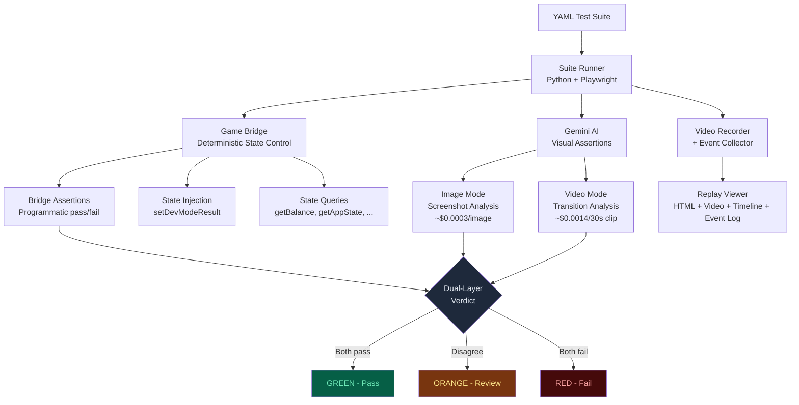

# QA Platform — Automated Game Testing Framework

An AI-powered end-to-end testing framework for slot games, combining a deterministic **Game Bridge** for state control with **Gemini AI** visual assertions and full **video replay** for debugging.

Built with Python, Playwright, and Google Gemini. Tests are defined in YAML — no code required from QA.

---

## Table of Contents

1. [Project Structure](#project-structure)
2. [What This Project Does](#what-this-project-does)
3. [Why Game Bridge?](#why-game-bridge)
4. [How QA Uses This Framework](#how-qa-uses-this-framework)
5. [Dual-Layer Assertion System](#dual-layer-assertion-system)
6. [Replay Feature](#replay-feature)
7. [AI Assertion Capabilities](#ai-assertion-capabilities)
8. [Does This Replace QA?](#does-this-replace-qa)
9. [Implementation Result](#implementation-result)
10. [Roadmap](#roadmap)
11. [Quick Start](#quick-start)

---

## Project Structure

```
qa-platform/
  framework/
    runner/          Suite runner, step executor, reporter, video AI processor
    helpers/         Bridge wrapper, artifact management, Gemini helpers, network control
    detection/       Symbol detection (pHash + Gemini hybrid)
    templates/       Replay viewer HTML template
  games/
    zeus/            Game-specific config, test suites, docs, assets
  shared-mechanisms/ Cross-game feature guides (auto-spin, hold-and-spin, etc.)
  scripts/           CLI utilities
  tests/             Framework unit tests (pytest)
  test-results/      Generated test artifacts
```

---

## What This Project Does

This framework automates the repetitive, time-consuming parts of slot game QA. Instead of manually clicking through hundreds of game states, QA engineers define test cases in YAML files. The framework then:

1. Launches the game in a headless browser
2. Drives the game through test scenarios via the Game Bridge
3. Asserts correctness using both programmatic checks (bridge) and visual AI (Gemini)
4. Records full video with timestamped event logs for investigation
5. Generates HTML reports with pass/fail verdicts

### Architecture



---

## Why Game Bridge?

The Game Bridge is the foundation of reliable test automation. It exposes methods that bind directly to game UI buttons and state — the same code path a real player uses.

### The Problem with Screen-Based Automation

Traditional approaches (capture screen, find elements by coordinates, click at X,Y) are fragile:

- **Non-deterministic:** Screenshot analysis can misread values, colors shift between renders
- **Fragile coordinates:** A UI layout change breaks every test
- **No state awareness:** The automation doesn't know what buttons are disabled, what the game state is, or whether an action is valid
- **Slow feedback:** You only discover failures after processing screenshots

### How the Bridge Solves This

The bridge exposes methods like `spin()`, `nextBet()`, `getBalance()`, `isSpinEnabled()` that:

- **Simulate real user interactions** through the actual UI code path (not direct internal calls)
- **Provide deterministic state access** — know exactly what the balance is, what bet is selected, whether a button is interactable
- **Enable state injection** via `setDevModeResult()` to test specific scenarios (e.g., trigger a bonus with exactly 3 coins)
- **Are programmatically assertable** — compare `getBetIndex()` to an expected value instantly, no AI needed

### Does the Bridge Add Complexity?

Yes, but the cost is minimal and pays back quickly:

- **90% shared mechanics:** Slot games share common patterns (spin, bet, auto-spin, bonus). The bridge interface is designed to be reused and extended across games. After the first implementation, applying it to another game is straightforward.
- **Minimal code footprint:** The bridge only touches the codebase at the activator function. All bridge methods import from the game's existing controllers and managers — it doesn't modify game logic.
- **Similar to existing patterns:** We already implement something similar with Game Analytics (GA) — sending correct information at the exact function that runs it. The bridge follows the same principle but for test automation.
- **One-time investment:** Once the bridge interface is established, new games only need to implement the concrete bridge class and activator.

---

## How QA Uses This Framework

### Workflow Overview

```
1. /init-knowledge    Create game knowledge files from game docs
        |
2. /write-test        Generate YAML test suites from knowledge + test cases
        |
3. /run-test          Execute tests, get results, investigate failures
        |
4. Report & Fix       Write bug issues from gathered information
```

### Step 1: Initialize Game Knowledge

QA gathers game documentation (design docs, paytable, mechanics) and runs:

```
/init-knowledge --game=zeus
```

This creates:
- `game-knowledge.md` — game overview, symbols, mechanics
- `bridge-api.md` — bridge method reference
- `symbols.yml` — asset manifest for AI assertions

### Step 2: Write Tests

QA provides test cases (from Excel, manual descriptions, or scope-based generation):

```
/write-test --game=zeus --suite=test3 --raw="test-case.xlsx"
```

The skill walks through each test case in an approval loop, generating YAML that:
- Uses correct bridge methods from `bridge-api.md`
- Includes dual assertions (bridge + AI)
- References correct assets from `symbols.yml`
- Follows the framework's supported action types

### Step 3: Run Tests

```
/run-test --game=zeus --suite=test3 --env=dev
```

Or directly via CLI:

```bash
python framework/runner/suite_runner.py --game zeus --suite test3 --env dev
```

Results include:
- Console output with color-coded verdicts
- `summary.json` + `summary.html` for the suite
- Per-test `result.json`, `result.html`, screenshots, video, replay viewer
- AI cost breakdown

### Step 4: Investigate & Report

QA reviews failures using:
- **Replay viewer** — video with synchronized event logs
- **Screenshots** — captured at assertion points
- **AI analysis results** — structured JSON responses
- **Bridge assertion details** — exact expected vs actual values

---

## Dual-Layer Assertion System

Every test uses two independent validators:

| Bridge Result | AI Result | Verdict | Meaning |
|---------------|-----------|---------|---------|
| Pass | Pass | **Green** | Both validators agree — test passed |
| Pass | Fail | **Orange** | Human review needed — AI sees something different |
| Fail | Pass | **Orange** | Bridge failed but UI looks correct — possible bridge issue |
| Fail | Fail | **Red** | Both validators agree — test failed |

### Execution Strategy

The framework is cost-conscious with AI calls:

1. **Bridge assertions run first** — they're instant and free
2. **If bridge fails, the test is marked red immediately** — no AI call is made, saving cost
3. **AI assertions only run when bridge passes** — confirming the visual state matches the programmatic state
4. **Bridge failure = recheck bridge implementation** — the bridge is the source of truth for game state

This fail-fast approach means a broken bridge method doesn't waste Gemini API budget on tests that will fail anyway.

---

## Replay Feature

Every test run produces an interactive replay viewer (`replay.html`) that is invaluable for debugging:


- **Full video recording** (left panel) of the game during the test — seekable with playback speed control
- **Timestamped event log** (right panel) capturing every state change, spin result, balance change, button state, and server communication
- **Click-to-seek** — click any event to jump the video to that exact moment
- **Event detail popup** — click any event to see full JSON data with copy functionality
- **Step timeline** (bottom bar) — visual bar showing each test step with duration, click to jump
- **Filter by event type** (top bar) — toggle BAL, BTN, RESULT, STATE, STEP and more to focus on what matters

This is especially helpful for complex cases like bonus sequences, reconnection flows, or timing-sensitive bugs. Instead of trying to reproduce a bug manually, QA can review the exact sequence of events that led to the failure.

---

## AI Assertion Capabilities

### Image Analysis

Tested extensively with game screenshots. Results:

- **Symbol recognition:** 5/5 correct identification of symbols on the 3x3 grid after spin completion, even with overlapping win line animations
- **Value reading:** Correctly reads bet amount, balance, and win amount from UI labels
- **UI state detection:** Accurately identifies popups, disabled buttons, turbo indicators, and auto-spin counters
- **Before/after comparison:** Reliably detects changes between two screenshots (balance increased, bet changed, counter decremented)

### Video Analysis

Video mode handles cases where a single screenshot can't capture the full story:

- **Sequence verification:** Correctly describes multi-step sequences (auto-spin start → spins → stop)
- **Transition detection:** Identifies bonus entry animations, popup open/close sequences
- **State flow tracking:** Accurately traces state changes through complex flows

### Cost Analysis

We prioritize **image analysis** for cost efficiency. Video is reserved for cases requiring transition/animation verification.

**API pricing reference:**

| Model | Input | Output |
|-------|-------|--------|
| Gemini 2.5 Flash | $0.30 / 1M tokens | $2.50 / 1M tokens |
| Gemini 3 Flash Preview | $0.50 / 1M tokens | $3.00 / 1M tokens |

**Image analysis cost (Gemini 2.5 Flash):**

| Component | Tokens | Calculation | Cost |
|-----------|--------|-------------|------|
| Input (per image) | ~258 | 258 × $0.30 / 1M | $0.0000774 |
| Output (per assertion) | ~50–100 | 100 × $2.50 / 1M | $0.000250 |
| **Total per image** | | | **~$0.0003** |
| **Per test (1-2 images)** | | | **$0.0003–$0.0007** |

**Video analysis cost (Gemini 3 Flash, 30s video):**

We choose Gemini 3 Flash for video because input tokens per frame drop from 258 (Gemini 2.5) to 70 (Gemini 3 at medium resolution) — making video ~2x cheaper. Video assertions require more output tokens than image (500–1000 tokens) because the AI must reason about sequences, transitions, and temporal relationships across frames.

| Component | Tokens | Calculation | Cost |
|-----------|--------|-------------|------|
| Input (70 tokens/frame × 30 frames) | 2,100 | 2,100 × $0.50 / 1M | $0.00105 |
| Output (reasoning + structured response) | ~500–1000 | 1,000 × $3.00 / 1M | $0.003000 |
| **Total per 30s video** | | | **~$0.004** |

For comparison, the same 30s video on Gemini 2.5 Flash would cost: 258 × 30 = 7,740 input tokens → $0.00232 input + 1,000 × $2.50/1M = $0.0025 output = **~$0.005** (more expensive, and higher input token count).

We limit video assertions to **<30 seconds** per clip to keep costs predictable.

**Example suite cost (20 tests):**

| Type | Count | Unit Cost | Total |
|------|-------|-----------|-------|
| Image assertions | 20 tests × 2 images | $0.0003 | $0.012 |
| Video assertions | 3 tests × 30s | $0.004 | $0.012 |
| **Suite total** | | | **~$0.024** |

Running the full suite costs roughly **about two cents**. Even running 100 times per day would cost ~$2.40/day.

---

## Does This Replace QA?

**No — but it significantly multiplies QA effectiveness.**

### What It Does Well

- **Repetitive regression testing** — run the same 50 tests after every build in minutes, not hours
- **Safety net** — catch regressions that slip through manual testing
- **Fast smoke checks** — verify basic game functionality before deeper manual testing
- **Hard-to-reproduce scenarios** — use `setDevModeResult()` to deterministically trigger rare events (9-coin full grid, specific symbol combinations)
- **Investigation support** — replay viewer with full event logs saves hours of manual reproduction
- **Overnight/CI runs** — tests can run unattended and report results by morning

### What Still Needs a Human

- **Visual design review** — does the animation feel right? Is the timing satisfying?
- **Exploratory testing** — finding unexpected bugs through creative interaction
- **UX judgment** — is the popup too slow? Is the button placement intuitive?
- **Edge cases that need human intuition** — "something feels off about this transition"

The framework handles the tedious, repeatable work so QA can focus on the creative, judgment-heavy testing that humans do best.

---

## Implementation Result

The framework has been applied to the **Zeus (Zappin Zeus)** slot game as a proof of concept. Here is the end-to-end pipeline in action:

### 1. Game Knowledge Created

**Input:** Raw game design document at `games/zeus/docs/raw/Doc Zappin zeus.md`

**Output:** The `/init-knowledge` skill processed the document and generated:
- `games/zeus/game-knowledge.md` — structured game overview: symbols, mechanics, paylines, win types, Hold & Spin bonus rules
- `games/zeus/bridge-api.md` — full bridge method reference with 21 actions, 30+ queries, state machine diagrams
- `games/zeus/docs/assets/symbols.yml` — asset manifest with 9 symbols and 15 UI elements

### 2. Test Suite Generated

**Input:** QA raw test cases from `test-case.xlsx` (52 test cases covering UI, denomination, bet, balance, auto-spin, turbo, reconnect, Hold & Spin, buy bonus, and more)

**Output:** The `/write-test` skill processed the Excel file through an approval loop and generated:
- `games/zeus/test-suites/test3.yml` — 20 approved test cases in executable YAML format

Each test includes bridge assertions for deterministic state verification and AI assertions for visual confirmation. Tests that couldn't be automated (e.g., no `setBalance` in bridge, multi-tab scenarios, hardware-level network switching) were flagged with reasons.

### 3. Test Execution & Results

**Command:** `/run-test --game=zeus --suite=test3 --env=dev`

**Output:** Full test results available at `test-results/zeus/dev/test-13-04-2026-1143/`

Each test directory contains:
- `result.json` + `result.html` — verdict with bridge/AI sub-results
- `session.webm` — full video recording of the test
- `replay.html` — interactive replay viewer with event timeline
- `events.jsonl` — timestamped event log (state changes, spin results, balance changes)
- `timeline.json` — step execution timing
- Step screenshots (`step-01.jpg`, `step-02.jpg`, ...)
- `summary.json` + `summary.html` — suite-level overview with cost breakdown

---

## Roadmap

### Alternative AI Models

Investigating open-source models to reduce or eliminate API costs:

- **Qwen AI & Gemma AI** — Can they replace Gemini for visual assertions?
- **Status:** RunPod setup complete. Qwen can accept image/video uploads and answer questions. Need to evaluate accuracy compared to Gemini for our specific use cases (symbol recognition, value reading, state detection).
- **RunPod pricing:** ~$0.30/hour server cost. Break-even vs Gemini API depends on test volume.

### Prompt Caching

Cache reference assets (symbol images, UI element references) that are reused across many API calls. This reduces input tokens significantly when the same symbols.yml assets are sent with every assertion.

### Parallel Sub-Agent Execution

Run multiple test assertions in parallel to reduce total suite execution time. Currently limited by hardware — video recording is resource-intensive with a single browser context.

### Complex Test Scenarios

Expand coverage to multi-step scenarios:
- Full Hold & Spin bonus flow with coin accumulation
- Auto-spin with bonus triggers mid-session
- Reconnection during active bonus

### Game State Helpers

Add bridge helpers for non-standard test setups:
- Set free spin paytable configuration for free spin testing
- Set promotion state for promo mode testing
- Set balance for edge case testing (insufficient funds)

---

## Quick Start

```bash
# Install dependencies
pip install -r requirements.txt
playwright install chromium

# Set up environment
cp .env.example .env
# Add GEMINI_API_KEY to .env

# Run a test suite
python framework/runner/suite_runner.py --game zeus --suite test3 --env dev
```

---

*Built for game QA teams who want to ship faster with fewer regressions.*
