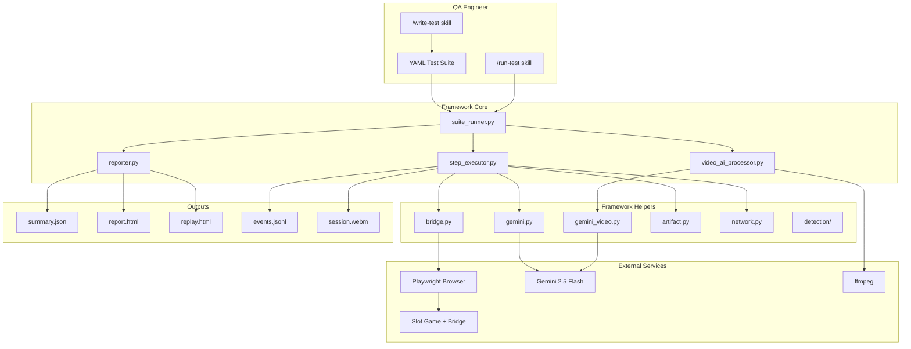
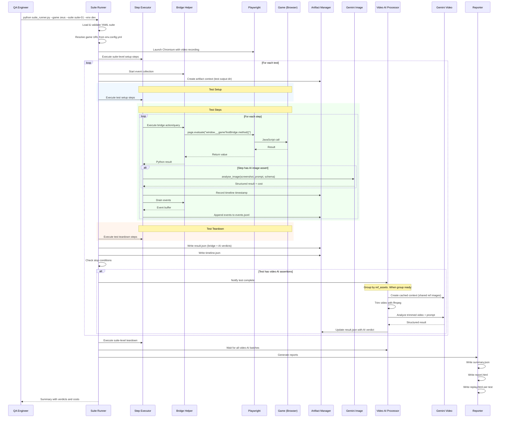
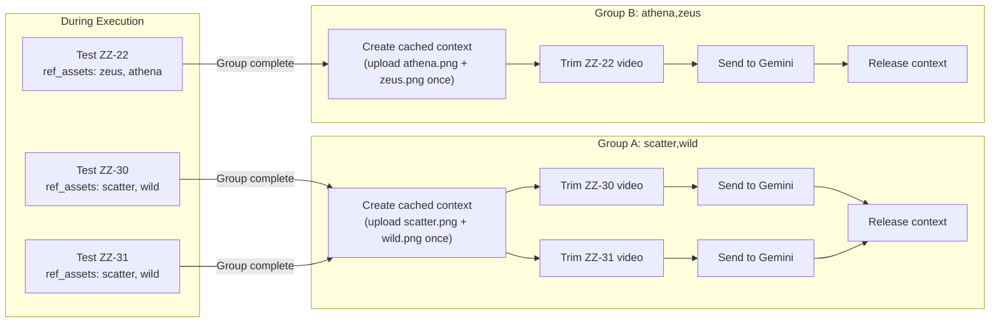

# QA Platform — Comprehensive Guide

A complete guide to setting up, configuring, and using the QA automation platform for slot game E2E testing.

---

## Table of Contents

- [Overview](#overview)
- [Architecture](#architecture)
- [Initial Setup](#initial-setup)
- [Main Execution Flow](#main-execution-flow)
- [Onboarding a New Game](#onboarding-a-new-game)
- [Writing Test Suites](#writing-test-suites)
- [Running Tests](#running-tests)
- [Understanding Results](#understanding-results)
- [Video AI Assertions](#video-ai-assertions)
- [Replay Viewer](#replay-viewer)
- [Symbol Detection](#symbol-detection)
- [Claude Code Skills](#claude-code-skills)
- [CLI Reference](#cli-reference)
- [Configuration Reference](#configuration-reference)
- [Troubleshooting](#troubleshooting)

---

## Overview

The QA Platform automates E2E testing for slot games using:

1. **Bridge Assertions** — Deterministic state checks via the game's test bridge API
2. **AI Image Assertions** — Single-frame screenshot analysis via Gemini 2.5 Flash
3. **AI Video Assertions** — Video sequence analysis via Gemini 2.5 Flash with context caching

Tests are defined in YAML, executed via Playwright, and results are presented with a triple-validation verdict model (green/orange/red).

---

## Architecture



### Component Overview

| Layer | Component | Purpose |
|-------|-----------|---------|
| **Runner** | `suite_runner.py` | Orchestrates full suite execution with timeouts and stop conditions |
| **Runner** | `step_executor.py` | Dispatches YAML step actions to helper methods |
| **Runner** | `video_ai_processor.py` | Streaming batch video AI pipeline with ffmpeg trimming |
| **Runner** | `reporter.py` | Generates summary.json, report.html, and replay.html |
| **Helper** | `bridge.py` | Python wrapper for Playwright-to-bridge communication |
| **Helper** | `gemini.py` | Gemini 2.5 Flash image analysis with structured output |
| **Helper** | `gemini_video.py` | Gemini 2.5 Flash video analysis with context caching |
| **Helper** | `artifact.py` | Test artifact file management (screenshots, video, events) |
| **Helper** | `network.py` | Browser network condition control (offline/online/throttle) |
| **Detection** | `detection/` | Symbol identification via pHash and/or Gemini |

---

## Initial Setup

### Prerequisites

| Requirement | Version | Purpose |
|-------------|---------|---------|
| Python | 3.12+ | Runtime |
| ffmpeg | Any recent | Video trimming for AI assertions |
| Node.js | (optional) | Only if game runs locally |

### Step 1: Clone and Install

```bash
cd D:\Project\qa-platform

# Create virtual environment
python -m venv .venv

# Activate (Windows)
.venv\Scripts\activate

# Activate (Linux/macOS)
source .venv/bin/activate

# Install Python dependencies
pip install -r requirements.txt

# Install Playwright browsers
python -m playwright install chromium
```

### Step 2: Configure Environment

```bash
# Copy environment template
cp .env.example .env

# Edit .env and set your Gemini API key
# GEMINI_API_KEY=your-actual-api-key-here
```

> **Note:** The Gemini API key is only required for AI assertions (image and video mode). Bridge-only tests work without it.

### Step 3: Verify ffmpeg

```bash
ffmpeg -version
```

If not installed, download from [ffmpeg.org](https://ffmpeg.org/download.html) and add to your PATH.

### Step 4: Verify Installation

```bash
# Run the test suite to verify everything works
python -m pytest tests/ -v

# Verify framework imports
python -c "from framework.helpers import BridgeHelper, GeminiImageHelper; print('OK')"
```

---

## Main Execution Flow



---

## Onboarding a New Game

### Directory Structure

Create the following structure under `games/{game-name}/`:

```
games/
  {game-name}/
    docs/
      raw/                    # Raw source documents (PDF, Excel, images, markdown)
        paytable.pdf
        game-rules.xlsx
      assets/
        symbols.yml           # Asset manifest (symbol + UI reference images)
        symbols/              # Reference PNG images for AI context
          scatter.png
          wild.png
          ...
        ui/
          spin-button.png
    bridge-api.md             # Bridge API reference (maintained by game dev)
    env.config.yml            # Per-environment configuration
    game-knowledge.md         # AI-generated game knowledge (via /init-knowledge)
    .docs-hash.json           # File hashes for change detection
    test-suites/
      suite-01-core.yml
      suite-02-balance.yml
      ...
```

### Step-by-Step

1. **Create the game directory** with the structure above
2. **Add raw documentation** to `docs/raw/` (game rules, paytable, anything useful)
3. **Write `bridge-api.md`** documenting the game's test bridge methods
4. **Create `env.config.yml`** with your environment URLs
5. **Create `symbols.yml`** manifest listing all game symbols and UI elements
6. **Add reference images** to `docs/assets/symbols/` and `docs/assets/ui/`
7. **Run `/init-knowledge`** to generate `game-knowledge.md`
8. **Write test suites** manually or via `/write-test`

### Environment Configuration (`env.config.yml`)

```yaml
environments:
  dev:
    # Option A: Static URL
    url: "https://dev.example.com/games/my-game"
    # Option B: Dynamic URL via script
    url_script: "python scripts/get_url.py --env=dev"
    # Query params appended to URL (include ?bridge=1 for test bridge)
    browser_params: "?bridge=1&debug=1"

  staging:
    url_script: "python scripts/get_url.py --env=staging"
    browser_params: "?bridge=1"

  prod:
    url_script: "python scripts/get_url.py --env=prod"
    browser_params: ""

# Symbol detection settings
detection:
  method: both              # "phash" | "gemini" | "both"
  phash_threshold: 10       # Hamming distance threshold (0 = exact match)
  fallback: gemini          # Fallback when phash confidence is low
```

### Asset Manifest (`symbols.yml`)

```yaml
symbols:
  scatter:
    file: symbols/scatter.png
    name: "Scatter (Lightning Bolt)"
    type: scatter
    description: "Golden lightning bolt. Triggers free spins when 3+ land."

  wild:
    file: symbols/wild.png
    name: "Wild (Golden Eagle)"
    type: wild
    description: "Golden eagle. Substitutes for all except scatter."

  zeus:
    file: symbols/zeus.png
    name: "Zeus"
    type: high
    description: "Zeus portrait with white beard. Highest paying regular symbol."

ui_elements:
  spin_button:
    file: ui/spin-button.png
    name: "Spin Button"
    description: "Green circular button at bottom center of screen."
```

---

## Writing Test Suites

### YAML Structure

```yaml
suite: "Display Name for Reports"
game: zeus                          # Must match games/{game}/ directory
version: "1.0"

config:
  detection_method: both            # phash | gemini | both
  video: true                       # Enable video recording
  test_timeout_ms: 60000            # Per-test timeout (60s)
  suite_timeout_ms: 600000          # Suite-wide timeout (10min)
  stop_conditions:
    fail_fast: false                # Stop on first failure?
    max_consecutive_failures: 3     # Stop after N consecutive reds
    max_total_failures: 10          # Stop after N total reds

# Runs once before all tests (e.g., navigate to game)
setup:
  - action: navigate
    params: { url_script: "get_game_url" }
  - action: wait_for_state
    params: { state: "idle", timeout_ms: 15000 }

# Runs once after all tests
teardown: []

tests:
  - id: ZZ-01
    title: "Game loads to idle state"
    description: "Verify initial game state after load"

    # Per-test setup (optional)
    setup:
      - action: bridge_action
        params: { name: "setDevModeResult", grid: [[1,3,4],[3,4,1],[4,1,3]] }

    steps:
      - id: step-01
        action: bridge_action
        params: { name: "spin" }

      - id: step-02
        action: wait_for_state
        params: { state: "idle", timeout_ms: 10000 }

      - id: step-03
        description: "Verify balance decreased"
        assert:
          bridge:
            method: getBalance
            expected: 999

    # Per-test teardown (optional)
    teardown:
      - action: bridge_action
        params: { name: "resetDevMode" }
```

### Step Action Types

| Action | Parameters | Description |
|--------|-----------|-------------|
| `navigate` | `url` (string) | Open URL in browser |
| `wait_for_state` | `state` (string), `timeout_ms` (int, default 30000) | Poll bridge until app state matches |
| `bridge_action` | `name` (string), plus extra params | Call a bridge action method |
| `bridge_assert` | `method` (string), `expected` (any) | Read bridge value and compare |
| `capture` | — | Take and save a screenshot |
| `assert` | `bridge` and/or `ai` block | Run bridge and/or AI assertions |
| `script` | `cmd` (string) | Run a shell command |
| `go_offline` | — | Disconnect browser from network |
| `go_online` | — | Restore browser network |
| `press_key` | `key` (string, e.g. "Space") | Press keyboard key |
| `click` | `selector` (string) or `x`/`y` (numbers) | Click element or coordinate |
| `wait_ms` | `ms` (int) | Fixed delay |

### Assert Block

The `assert` action supports two layers that can be used independently or together:

```yaml
- id: step-03
  assert:
    # Layer 1: Deterministic bridge check
    bridge:
      method: getFreeSpinsRemaining    # Bridge query method name
      expected: 3                       # Expected return value

    # Layer 2: AI visual check
    ai:
      mode: image                       # "image" or "video"
      ref_screenshot: step-02           # Step ID for reference screenshot
      ref_assets: [coin, scatter]       # Asset manifest keys
      prompt: "How many free spins are shown on screen?"
      output_schema:
        free_spins: { type: number }
        confidence: { type: string, enum: [high, medium, low] }
      expected:
        free_spins: 3
        confidence: high
```

### AI Video Assertions

For verifying animations and transitions:

```yaml
ai:
  mode: video
  video_trim:
    from_step: step-01              # Video segment start
    to_step: step-03                # Video segment end
  ref_assets: [scatter, wild]       # Shared reference images
  prompt: |
    Watch this slot game spin.
    1. Did reels spin then stop?
    2. What symbols landed in the 3x3 grid?
  output_schema:
    reels_spun: { type: boolean }
    result_grid: { type: array }
    confidence: { type: string, enum: [high, medium, low] }
  expected:
    reels_spun: true
    confidence: high
```

### Validate Your YAML

```python
import yaml
from framework.schema_validator import validate_suite

with open("games/zeus/test-suites/suite-01-core.yml") as f:
    doc = yaml.safe_load(f)

errors = validate_suite(doc, source="suite-01-core.yml")
for e in errors:
    print(e)  # "[suite-01-core.yml] tests[0].steps[1].action: unsupported action type 'fly'"
```

---

## Running Tests

### Command Line

```bash
# Basic execution
python framework/runner/suite_runner.py --game zeus --suite suite-01-core --env dev

# With explicit base directory
python framework/runner/suite_runner.py --game zeus --suite suite-06-freespin --env staging --base-dir D:\Project\qa-platform
```

| Argument | Required | Description |
|----------|----------|-------------|
| `--game` | Yes | Game identifier (matches `games/{game}/`) |
| `--suite` | Yes | Suite file name without `.yml` extension |
| `--env` | Yes | Environment name from `env.config.yml` |
| `--base-dir` | No | Repository root (auto-detected if omitted) |

### Exit Codes

| Code | Meaning |
|------|---------|
| 0 | All tests passed (no red verdicts) |
| 1 | One or more failures, or startup error |

### Via Claude Code Skill

```
/run-test --game=zeus --suite=suite-01-core --env=dev
```

The skill runs the suite, reads the summary, and presents results in a color-coded format with cost breakdown.

---

## Understanding Results

### Output Directory

```
test-results/{game}/{env}/{YYYY-MM-DD}-{suite}/
  summary.json              # Per-test verdicts, counts, cost breakdown
  report.html               # Color-coded HTML report
  {test-id}/
    result.json             # Individual test verdict
    timeline.json           # Step timestamps with video offset
    events.jsonl            # Bridge event log (one JSON per line)
    session.webm            # Full test video recording
    replay.html             # Synchronized video + event viewer
    step-01.png             # Screenshots
    step-01-ai.json         # Gemini AI response
    trimmed.webm            # Trimmed video segment (if video AI used)
```

### Triple-Validation Verdict Model

Each test gets a final verdict based on two independent checks:

| Bridge | AI | Verdict | Meaning |
|--------|----|---------|---------|
| pass | pass | **green** | Both agree — test passes |
| pass | fail | **orange** | Disagreement — needs human review |
| fail | pass | **orange** | Disagreement — needs human review |
| fail | fail | **red** | Both agree — test fails |
| pass | skip | **green** | No AI assertion — bridge-only pass |
| any | pending | **pending** | Video AI not yet processed |
| skip | skip | **skip** | No assertions executed |

### summary.json Structure

```json
{
  "suite": "Core UI & Basic Spin",
  "game": "zeus",
  "env": "dev",
  "run_date": "2026-04-10",
  "duration_ms": 45200,
  "total": 9,
  "counts": {
    "green": 7,
    "orange": 1,
    "red": 1,
    "pending": 0,
    "skip": 0
  },
  "stop_reason": null,
  "tests": [
    {
      "test_id": "ZZ-01",
      "title": "Game loads to idle state",
      "bridge_result": "pass",
      "ai_result": "pass",
      "final_verdict": "green",
      "duration_ms": 3200,
      "timed_out": false,
      "error": null,
      "artifact_dir": "test-results/zeus/dev/2026-04-10-suite-01-core/ZZ-01"
    }
  ],
  "costs": {
    "gemini_image_calls": 12,
    "gemini_video_calls": 0,
    "gemini_input_tokens": 45000,
    "gemini_output_tokens": 3200,
    "estimated_cost_usd": 0.08
  }
}
```

### Stop Conditions

| Condition | Config Key | Behavior |
|-----------|------------|----------|
| Fail fast | `fail_fast: true` | Stop suite on first red verdict |
| Max consecutive | `max_consecutive_failures: 3` | Stop after 3 reds in a row |
| Max total | `max_total_failures: 10` | Stop after 10 total reds |

When triggered, remaining tests are skipped and `stop_reason` is set in the summary.

### Timeout Handling

- **Per-test:** `config.test_timeout_ms` (default: 60s). Exceeding kills the browser context, saves partial artifacts, marks test as `TIMEOUT`.
- **Per-suite:** `config.suite_timeout_ms` (default: 600s). Overall wall-clock limit.

---

## Video AI Assertions

### How It Works

Video AI assertions use a **streaming batch model** — tests are grouped by shared reference assets, and each batch is dispatched to Gemini as soon as all tests in the group complete.



### Reprocessing Failed Video AI

If Gemini was unavailable or you want to retry with updated prompts:

```bash
python framework/runner/video_ai_processor.py \
  --results-dir test-results/zeus/dev/2026-04-10-suite-06-freespin \
  --game zeus
```

This re-processes all `ai_result: pending` or `ai_result: fail` tests without re-running the suite.

---

## Replay Viewer

Each test produces a self-contained `replay.html` file. Open it in any browser — no server needed.

```
+-----------------------------------------------------------+
| Test: ZZ-30 | Suite: suite-06 | Result: PASS  | 5.2s      |
+---------------------------+-------------------------------+
|                           | EVENTS LOG [filter toggles]   |
|   VIDEO PLAYER            | +---------------------------+ |
|   +-----------------+     | | 0.00s STATE READY->IDLE   | |
|   |                 |     | | 1.50s SPIN  stake=1.00    | |
|   |   <video>       |     | | 1.72s RESULT payout=0     | |
|   |                 |     | | 1.72s BAL   1000->999     | |
|   +-----------------+     | | >2.95s STATE RESULT->IDLE | |
|   > || ===*=== 5.2s      | +---------------------------+ |
+---------------------------+-------------------------------+
| Step Timeline: [step-01]  [step-02]  [step-03]            |
+-----------------------------------------------------------+
```

### Synchronization

- **Video plays** -> events appear progressively up to current time
- **Seek video** -> event log filters to events up to seek time
- **Click event row** -> video seeks to that event's timestamp
- **Click step segment** -> video seeks to step's start time
- **Speed control** -> 0.5x, 1x, 2x playback

### Event Types and Colors

| Type | Badge | Color | Source |
|------|-------|-------|--------|
| `state_change` | STATE | Yellow #f59e0b | App state transitions |
| `spin_request` | SPIN | Blue #3b82f6 | Bridge spin action |
| `spin_result` | RESULT | Green #10b981 | Bet result received |
| `balance_change` | BAL | Cyan #06b6d4 | Balance update |
| `socket_send` / `socket_recv` | SOCK | Gray #6b7280 | WebSocket traffic |
| `button_state` | BTN | Indigo #6366f1 | Button interactability |
| `free_spin` | FREE | Orange #f97316 | Free spin count change |
| `bonus_transition` | BONUS | Pink #ec4899 | Bonus mode transition |
| `popup` | POPUP | Amber #d97706 | Popup show/hide |
| `turbo_change` | TURBO | Purple #8b5cf6 | Turbo toggle |
| `error` | ERROR | Red #ef4444 | App error state |

---

## Symbol Detection

The platform supports three detection modes for identifying game symbols in screenshots:

| Mode | Speed | Cost | Best For |
|------|-------|------|----------|
| `phash` | ~5ms | Free | Static idle symbols, clean renders |
| `gemini` | ~1-2s | API cost | Symbols with glow/effects, animations |
| `both` | ~2s | API cost | Maximum confidence |

### "Both" Mode Pipeline

1. Run pHash first — compute perceptual hash, compare against references
2. If Hamming distance <= threshold -> high confidence, return pHash result
3. If Hamming distance > threshold -> also run Gemini
4. If pHash and Gemini agree -> return with high confidence
5. If they disagree -> flag orange, save both results for human review

Configure per-game in `env.config.yml`:

```yaml
detection:
  method: both          # phash | gemini | both
  phash_threshold: 10   # Hamming distance cutoff
  fallback: gemini      # Used when phash is uncertain
```

---

## Claude Code Skills

Four Claude Code skills provide an AI-assisted QA workflow:

### `/init-knowledge --game={name}`

Onboard a new game by consolidating raw documentation into structured knowledge.

**Inputs:** Everything in `games/{game}/docs/raw/`
**Outputs:** `game-knowledge.md`, `.docs-hash.json`, initial `symbols.yml`

The skill:
1. Reads all docs (PDF, Excel, images, markdown)
2. Loads shared mechanism files and matches against game docs
3. Presents mechanism detection results to QA for confirmation
4. Generates structured game knowledge

### `/update-knowledge --game={name}`

Refresh game knowledge when documentation changes.

1. Computes SHA-256 of every file in `docs/`
2. Compares against stored `.docs-hash.json`
3. If changes detected -> full regeneration via init-knowledge
4. If no changes -> reports "No changes detected"

### `/write-test --game={name} --suite={name} [--raw="..."] [--scope="..."]`

Generate or refine test cases into executable YAML.

The skill:
1. Reads game knowledge, bridge API, shared mechanisms, and asset manifest
2. Generates test cases with appropriate assertion modes (image vs video)
3. Presents each test to QA for approval (approve / change / skip)
4. Writes validated YAML suite file

### `/run-test --game={name} --suite={name} --env={env}`

Execute a test suite and present results.

The skill:
1. Validates environment configuration
2. Runs `suite_runner.py` as subprocess
3. Reads summary.json and presents color-coded results
4. Shows cost breakdown and artifact paths

---

## CLI Reference

### Suite Runner

```bash
python framework/runner/suite_runner.py \
  --game GAME \
  --suite SUITE \
  --env ENV \
  [--base-dir DIR]
```

### Video AI Processor (Standalone)

```bash
python framework/runner/video_ai_processor.py \
  --results-dir DIR \
  --game GAME \
  [--base-dir DIR]
```

### Reporter (Standalone)

```bash
python framework/runner/reporter.py \
  --results-dir DIR \
  [--template-dir DIR]
```

### URL Resolver

```bash
python scripts/get_url.py --game GAME --env ENV
```

---

## Configuration Reference

### Environment Variables

| Variable | Required | Default | Purpose |
|----------|----------|---------|---------|
| `GEMINI_API_KEY` | For AI assertions | None | Gemini 2.5 Flash API key |

### Suite Config Block

| Field | Type | Default | Purpose |
|-------|------|---------|---------|
| `detection_method` | string | `"both"` | Symbol detection mode |
| `video` | boolean | `true` | Enable video recording |
| `test_timeout_ms` | integer | `60000` | Per-test timeout (ms) |
| `suite_timeout_ms` | integer | `600000` | Suite-wide timeout (ms) |
| `stop_conditions.fail_fast` | boolean | `false` | Stop on first failure |
| `stop_conditions.max_consecutive_failures` | integer | — | Stop after N consecutive failures |
| `stop_conditions.max_total_failures` | integer | — | Stop after N total failures |

### Supported Bridge Methods (Zeus)

<details>
<summary>Actions (22 methods) — click to expand</summary>

| Method | Parameters | Description |
|--------|-----------|-------------|
| `spin()` | — | Trigger spin via UI path |
| `stopSpin()` | — | Stop reel animation |
| `nextBet()` | — | Click next bet button |
| `previousBet()` | — | Click previous bet button |
| `selectBet(index)` | `index: int` | Select denomination |
| `openAutoPopup()` | — | Open auto-spin popup |
| `startAutoSpin(count, stopByWin)` | `count: int, stopByWin: bool` | Start auto-spin |
| `stopAutoSpin()` | — | Stop auto-spin |
| `openBuyBonusPopup()` | — | Open buy bonus popup |
| `confirmBuyBonus(packageIndex)` | `packageIndex: int` | Confirm bonus purchase |
| `setTurbo(enabled)` | `enabled: bool` | Toggle turbo mode |
| `setSound(enabled)` | `enabled: bool` | Toggle sound |
| `openSettings()` | — | Open settings modal |
| `openInfo()` | — | Open paytable/info |
| `openHistory()` | — | Open game history |
| `holdSpinStart()` | — | Start hold-spin in bonus |
| `holdSpinRelease()` | — | Release hold-spin |
| `skipBonusTransition()` | — | Skip Hold&Spin entry |
| `skipBigWin()` | — | Skip big win animation |
| `openDevMode()` | — | Open dev mode panel |
| `setDevModeResult(grid)` | `grid: number[][]` | Inject 3x3 result grid |
| `openTrophy()` | — | Open trophy display |

</details>

<details>
<summary>Queries (20+ methods) — click to expand</summary>

| Method | Returns | Description |
|--------|---------|-------------|
| `getAppState()` | string | Current app state (idle, betting, result...) |
| `getSpinState()` | string | Spin state (NORMAL, IN_BONUS...) |
| `getBalance()` | number | Player balance |
| `getBetAmount()` | number | Current bet |
| `getBetIndex()` | number | Bet index in denominations |
| `getDenominations()` | number[] | All bet levels |
| `getFreeSpinsRemaining()` | number | Free spins left |
| `getAutoSpinsRemaining()` | number | Auto spins left |
| `getLastPayout()` | number | Last spin payout |
| `getLastWinType()` | string | LOSE, SMALL_WIN, BIG_WIN... |
| `isTurboActive()` | boolean | Turbo enabled? |
| `isSoundEnabled()` | boolean | Sound on? |
| `getReelResult()` | number[][] | 3x3 symbol grid |
| `getCoinPositions()` | object[] | Coin positions in bonus |
| `getPaylines()` | object[] | Winning paylines |
| `isSpinEnabled()` | boolean | Spin button active? |
| `isBuyBonusEnabled()` | boolean | Buy bonus available? |
| `getSnapshot()` | object | Full state dump |
| `getDisplayBalance()` | string | Formatted balance label |
| `getDisplayBet()` | string | Formatted bet label |
| `getDisplayWin()` | string | Formatted win label |

</details>

---

## Troubleshooting

### Bridge not found

```
BridgeMissingError: Game test bridge not registered at window.__gameTestBridge
```

**Fix:** Ensure `browser_params` includes `?bridge=1` in `env.config.yml` for your environment.

### ffmpeg not found

```
FileNotFoundError: ffmpeg not found on PATH
```

**Fix:** Install ffmpeg and verify with `ffmpeg -version`. Required for video AI assertions.

### Gemini API errors

```
ai_result: fail, reason: "Gemini API unavailable"
```

**Fix:** Check `GEMINI_API_KEY` is set in `.env`. Re-process with:
```bash
python framework/runner/video_ai_processor.py --results-dir <path> --game <game>
```

### Test timeout

```
final_verdict: TIMEOUT
```

**Fix:** Increase `test_timeout_ms` in suite config. Check if the game is stuck (video recording is preserved for diagnosis).

### Schema validation errors

```
[suite-01.yml] $.config.test_timeout_ms: required field missing
```

**Fix:** Ensure all required fields are present. Run validation manually:
```python
from framework.schema_validator import validate_suite
# ... see "Validate Your YAML" section above
```

### pHash returns wrong symbol

**Fix:** Check if the reference image matches the in-game rendering. Try:
- Increasing `phash_threshold` (more lenient)
- Switching to `detection.method: gemini` for that game
- Using `both` mode — pHash fallback to Gemini when uncertain
