# Hướng Dẫn Sử Dụng QA Framework — Slot Game Test Automation

> **Đối tượng:** QA engineer viết và chạy test suite tự động
> **Cập nhật:** 2026-04-20

---

## Mục Lục

1. [Tổng Quan Framework](#1-tổng-quan-framework)
2. [Cài Đặt & Cấu Hình](#2-cài-đặt--cấu-hình)
3. [Quy Trình Làm Việc Toàn Bộ (Full Workflow)](#3-quy-trình-làm-việc-toàn-bộ)
4. [Command: /init-knowledge — Onboard Game Mới](#4-command-init-knowledge--onboard-game-mới)
5. [Command: /write-test — Tạo Test Suite](#5-command-write-test--tạo-test-suite)
6. [Command: /run-test — Chạy Test Suite](#6-command-run-test--chạy-test-suite)
7. [Command: /update-knowledge — Cập Nhật Khi Docs Thay Đổi](#7-command-update-knowledge--cập-nhật-khi-docs-thay-đổi)
8. [Cấu Trúc File YAML Test Suite](#8-cấu-trúc-file-yaml-test-suite)
9. [12 Action Types](#9-12-action-types)
10. [Viết Assertions](#10-viết-assertions)
11. [Đọc Kết Quả Test](#11-đọc-kết-quả-test)
12. [Replay Viewer](#12-replay-viewer)
13. [Hệ Thống Verdict](#13-hệ-thống-verdict)
14. [AI Assertion Chi Tiết](#14-ai-assertion-chi-tiết)
15. [Bridge API Tham Khảo Nhanh](#15-bridge-api-tham-khảo-nhanh)
16. [Chi Phí & Hiệu Suất](#16-chi-phí--hiệu-suất)
17. [Xử Lý Lỗi Thường Gặp](#17-xử-lý-lỗi-thường-gặp)
18. [Thuật Ngữ](#18-thuật-ngữ)

---

## 1. Tổng Quan Framework

Framework này tự động hóa việc test game slot bằng cách:

1. **Mở browser thật** và load game
2. **Điều khiển game** thông qua bridge API (được inject vào code game)
3. **Thực thi các step** — spin, đổi bet, mở popup, ngắt mạng, v.v.
4. **Kiểm tra kết quả** bằng 2 validator độc lập:
   - **Bridge assertion** — kiểm tra state nội bộ của game (balance, bet, app state)
   - **AI visual assertion** — gửi screenshot/video cho Google Gemini để xác nhận những gì người chơi thực sự nhìn thấy trên màn hình
5. **Tạo report** với verdict, screenshot, video và replay viewer tương tác

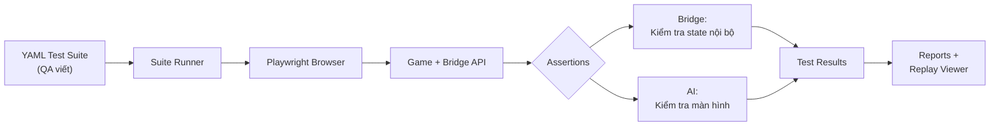

---

## 2. Cài Đặt & Cấu Hình

### Cài đặt dependencies

```bash
pip install -r requirements.txt
playwright install chromium
```

### Cấu hình environment

Copy file `.env.example` và thêm Gemini API key:

```bash
cp .env.example .env
```

Sửa file `.env`:

```ini
GEMINI_API_KEY=your-api-key-here
```

Lấy API key tại [Google AI Studio](https://aistudio.google.com/).

#### Chọn AI provider: Gemini hoặc Local AI

Framework hỗ trợ hai nhà cung cấp AI cho visual assertion (cả image lẫn video), chọn qua biến `AI_PROVIDER` trong `.env`:

```ini
# gemini (mặc định) — dùng Google Gemini API, cần GEMINI_API_KEY
AI_PROVIDER=gemini

# local — dùng endpoint AI tự host (on-prem), không tốn chi phí API
AI_PROVIDER=local
LOCAL_AI_ENDPOINT=http://192.168.1.35:9000/analyze
```

Khi `AI_PROVIDER=local`, framework gửi multipart POST tới `LOCAL_AI_ENDPOINT` với một `file` (screenshot hoặc video clip) và một `prompt`, rồi đọc trường `result` trong JSON trả về. Framework tự thêm hướng dẫn JSON-schema vào prompt và trích xuất JSON object từ phần text trả về để so khớp với `expected`.

Lưu ý ở chế độ local:
- Endpoint chỉ nhận **một file**, nên các ảnh tham chiếu (`ref_assets` của video, `extra_images` của image) sẽ bị bỏ qua.
- Chi phí (`estimated_cost_usd`) trong `summary.json` luôn bằng `0` vì model tự host không tính token.

### Kiểm tra Game Bridge

Game phải hỗ trợ tham số URL `?bridge=1`. Khi load với tham số này, game sẽ đăng ký object `window.__gameTestBridge` — đối tượng mà framework dùng để điều khiển và query game.

### Cấu Trúc Thư Mục Dự Án

```
qa-platform/
├── framework/                    # Code framework (không chỉnh sửa)
│   ├── runner/
│   │   ├── suite_runner.py       # Bộ thực thi test chính
│   │   ├── step_executor.py      # Xử lý từng step
│   │   ├── video_ai_processor.py # Xử lý AI video theo batch
│   │   └── reporter.py           # Tạo HTML report
│   ├── helpers/
│   │   ├── bridge.py             # Bridge API wrapper
│   │   ├── gemini.py             # AI assertion (image)
│   │   └── gemini_video.py       # AI assertion (video)
│   └── schema_validator.py       # Validate YAML
│
├── games/                        # Cấu hình theo từng game
│   └── zeus/
│       ├── env.config.dev.yml    # Config cho từng môi trường (1 file/môi trường)
│       ├── env.config.stg.yml    # vd: dev→.dev, staging→.stg, prod→.prod
│       ├── bridge-api.md         # Tài liệu bridge method
│       ├── game-knowledge.md     # Tài liệu mechanic của game
│       ├── test-suites/          # FILE TEST YAML CỦA BẠN Ở ĐÂY
│       └── docs/
│           ├── raw/              # Tài liệu gốc của game (PDF, Excel, MD)
│           └── assets/
│               └── symbols.yml   # Ảnh tham chiếu cho AI
│
├── shared-mechanisms/            # Hướng dẫn mechanic dùng chung
│   ├── hold-and-spin.md
│   ├── free-spin.md
│   ├── buy-bonus.md
│   ├── auto-spin.md
│   └── reconnect.md
├── test-results/                 # Kết quả test (tự tạo)
└── docs/                         # Tài liệu
```

---

## 3. Quy Trình Làm Việc Toàn Bộ

### Tổng Quan Quy Trình Từ Đầu Đến Cuối

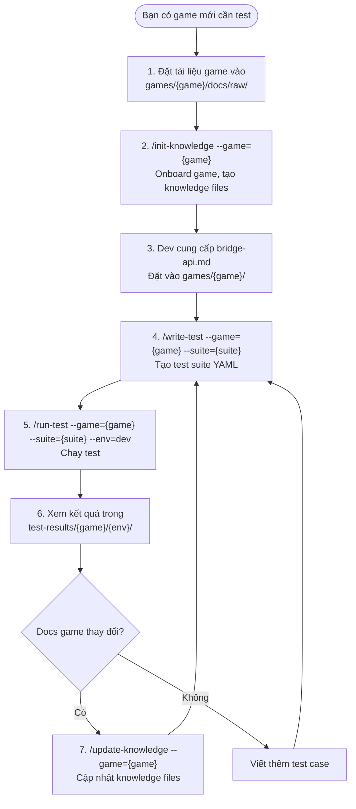

### Bảng Tổng Hợp Commands

| Command | Mục đích | Khi nào dùng | Input chính | Output chính |
|---------|---------|-------------|------------|-------------|
| `/init-knowledge` | Onboard game mới | Game mới chưa có `game-knowledge.md` | Tài liệu game (PDF, Excel, MD) | `game-knowledge.md`, `symbols.yml`, `.docs-hash.json` |
| `/write-test` | Tạo file test YAML | Cần viết test case mới | Knowledge files + mô tả test case | File `.yml` trong `test-suites/` |
| `/run-test` | Chạy test suite | Có file YAML sẵn sàng | File `.yml` + `env.config.yml` | Kết quả trong `test-results/` |
| `/update-knowledge` | Cập nhật knowledge | Tài liệu game thay đổi | Tài liệu mới + `.docs-hash.json` cũ | Knowledge files được cập nhật |

---

## 4. Command: /init-knowledge — Onboard Game Mới

### Công Dụng

Onboard một game mới vào hệ thống QA. Đọc tài liệu game (PDF, Excel, ảnh, Markdown), phát hiện các mechanic chung, xin xác nhận từ QA, rồi tạo các file knowledge có cấu trúc.

### Cú Pháp

```
/init-knowledge --game=zeus
```

### Điều Kiện Trước

Tài liệu game đã được đặt vào đúng thư mục:

```
games/{game}/docs/raw/
  ├── game-design-doc.pdf      # Tài liệu thiết kế game
  ├── paytable.xlsx            # Bảng trả thưởng
  ├── symbol-mapping.md        # Ánh xạ symbol
  └── ... (bất kỳ file nào)
```

### Quy Trình Từng Bước

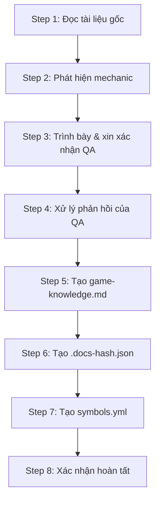

#### Step 1 — Đọc Tài Liệu Gốc

| | Chi tiết |
|---|---|
| **Input** | Tất cả file trong `games/{game}/docs/raw/` (PDF, Excel, MD, ảnh) |
| **Xử lý** | Đọc và phân tích nội dung: trích xuất symbol, payline, mechanic, win type, RTP |
| **Output** | Dữ liệu đã phân tích (giữ trong bộ nhớ, chưa ghi file) |

Đồng thời đọc các file shared mechanism:
- `shared-mechanisms/hold-and-spin.md`
- `shared-mechanisms/free-spin.md`
- `shared-mechanisms/buy-bonus.md`
- `shared-mechanisms/auto-spin.md`
- `shared-mechanisms/reconnect.md`

#### Step 2 — Phát Hiện Mechanic

| | Chi tiết |
|---|---|
| **Input** | Dữ liệu đã phân tích từ Step 1 + các file shared mechanism |
| **Xử lý** | Với mỗi mechanic (hold-and-spin, free-spin, buy-bonus, auto-spin, reconnect), tìm bằng chứng trong tài liệu và phân loại |
| **Output** | Kết quả phân loại theo 4 mức |

4 mức phân loại:

| Mức | Ý nghĩa |
|-----|--------|
| **CONFIRMED** | Tìm thấy bằng chứng rõ ràng trong tài liệu |
| **LIKELY** | Có dấu hiệu nhưng chưa chắc chắn |
| **ABSENT** | Tài liệu ghi rõ là không có |
| **UNKNOWN** | Không tìm thấy thông tin — cần xác nhận |

#### Step 3 — Trình Bày & Xin Xác Nhận QA

| | Chi tiết |
|---|---|
| **Input** | Kết quả phân loại mechanic từ Step 2 |
| **Hiển thị trên màn hình** | Bảng kết quả với mức độ tin cậy của từng mechanic |
| **Output** | Chờ QA xác nhận hoặc sửa |

QA sẽ thấy trên màn hình:

```
=== Mechanism Detection Results ===

[CONFIRMED] Hold & Spin
  Evidence: "3 or more COIN symbols trigger Hold & Spin bonus"
  Source: game-design-doc.pdf, page 12

[CONFIRMED] Auto Spin
  Evidence: "Packages: 10, 20, 30, 50, Infinity"
  Source: game-design-doc.pdf, page 8

[ABSENT] Free Spin
  Evidence: "FreeSpin symbol flagged as unused"
  Source: symbol-mapping.md

[UNKNOWN] Reconnect
  No evidence found in documentation.

Xác nhận kết quả? (yes / sửa: <mô tả>)
```

#### Step 4 — Xử Lý Phản Hồi Của QA

| | Chi tiết |
|---|---|
| **Input** | Phản hồi của QA (xác nhận hoặc sửa lại) |
| **Xử lý** | Cập nhật kết quả phân loại theo ý kiến QA |
| **Output** | Kết quả mechanic cuối cùng |

#### Step 5 — Tạo game-knowledge.md

| | Chi tiết |
|---|---|
| **Input** | Tất cả dữ liệu đã phân tích + kết quả mechanic đã xác nhận |
| **Xử lý** | Tạo file Markdown có cấu trúc |
| **Output** | `games/{game}/game-knowledge.md` |

File `game-knowledge.md` chứa các phần:

1. **Overview** — Tên game, theme, grid, payline, engine
2. **Symbols** — Bảng symbol đầy đủ với key, ID, loại, mô tả
3. **Paylines** — Định nghĩa payline
4. **Mechanics** — Mỗi mechanic đã xác nhận được mô tả chi tiết
5. **Bridge API Summary** — Tổng hợp method (nếu có `bridge-api.md`)
6. **Known Limitations** — Những gì không thể test
7. **Source Documentation Index** — Danh mục tài liệu gốc

#### Step 6 — Tạo .docs-hash.json

| | Chi tiết |
|---|---|
| **Input** | Tất cả file trong `games/{game}/docs/` |
| **Xử lý** | Tính SHA-256 hash cho từng file |
| **Output** | `games/{game}/.docs-hash.json` |

File này dùng để `/update-knowledge` so sánh sau này:

```json
{
  "generated_at": "2026-04-20T10:00:00Z",
  "files": {
    "docs/raw/game-design-doc.pdf": "a1b2c3d4...",
    "docs/raw/paytable.xlsx": "e5f6g7h8...",
    "docs/assets/symbols.yml": "i9j0k1l2..."
  }
}
```

#### Step 7 — Tạo symbols.yml

| | Chi tiết |
|---|---|
| **Input** | Thông tin symbol từ tài liệu + `game-knowledge.md` |
| **Xử lý** | Tạo asset manifest với key, tên, loại, ID, đường dẫn ảnh, mô tả |
| **Output** | `games/{game}/docs/assets/symbols.yml` |

Ví dụ output:

```yaml
symbols:
  wild:
    file: symbols/Wild.jpg
    name: "Wild (Golden Eagle)"
    type: wild
    # Symbol ID: 9
    description: "Substitutes for all symbols except Coin."

  coin:
    file: symbols/Coin.jpg
    name: "Coin (Hold & Spin)"
    type: bonus
    # Symbol ID: 13
    description: "Landing 3+ triggers Hold and Spin bonus."

ui_elements:
  spin_button:
    file: ui/spin-button.jpg
    name: "Spin Button"
    type: ui
    description: "Large circular button. Initiates a spin."
```

#### Step 8 — Xác Nhận Hoàn Tất

| | Chi tiết |
|---|---|
| **Hiển thị trên màn hình** | Tổng kết file đã tạo, mechanic đã ghi nhận, symbol đã phát hiện |

QA sẽ thấy:

```
=== init-knowledge complete ===

Files written:
  - games/zeus/game-knowledge.md (336 lines)
  - games/zeus/.docs-hash.json (5 files hashed)
  - games/zeus/docs/assets/symbols.yml (9 symbols, 14 UI elements)

Mechanics documented:
  [V] Hold & Spin
  [V] Buy Bonus
  [V] Auto Spin
  [X] Free Spin (absent)
  [?] Reconnect (unknown — confirm with dev)

Next steps:
  1. Dev cung cấp bridge-api.md → đặt vào games/zeus/
  2. Thêm ảnh tham chiếu vào games/zeus/docs/assets/symbols/
  3. Chạy /write-test --game=zeus --suite=suite-01
```

---

## 5. Command: /write-test — Tạo Test Suite

### Công Dụng

Tạo file YAML test suite tự động từ knowledge files, bridge API docs và shared mechanism patterns. Hỗ trợ chuyển đổi test case thủ công (từ Excel/mô tả) thành YAML có thể chạy được. Mỗi test được trình bày cho QA duyệt trước khi ghi file.

### Cú Pháp

```
/write-test --game=zeus --suite=test3
/write-test --game=zeus --suite=test3 --scope="hold and spin"
/write-test --game=zeus --suite=test3 --raw="test-case.xlsx"
```

### Tham Số

| Tham số | Bắt buộc | Mô tả |
|---------|---------|------|
| `--game` | Có | Tên game (vd: `zeus`) |
| `--suite` | Có | Tên file output (vd: `test3` → `test3.yml`) |
| `--raw` | Không | Mô tả test case hoặc đường dẫn file (Excel, text) |
| `--scope` | Không | Lọc theo mechanic: `free spin`, `hold and spin`, `reconnect`, `buy bonus`, `auto spin`, `base game`, `core` |

### Điều Kiện Trước

Các file sau **phải tồn tại** trước khi chạy:

| File | Tạo bởi | Mục đích |
|------|---------|---------|
| `games/{game}/game-knowledge.md` | `/init-knowledge` | Mechanic, symbol, payline của game |
| `games/{game}/bridge-api.md` | Dev team | Tên method và chức năng bridge API |
| `games/{game}/docs/assets/symbols.yml` | `/init-knowledge` | Manifest ảnh tham chiếu |
| `framework/schema_reference.md` | Script tự động | Định nghĩa action, param, assert hợp lệ |

### Quy Trình Từng Bước

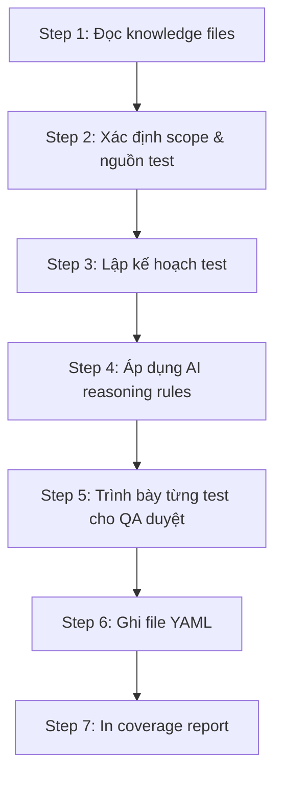

#### Step 1 — Đọc Knowledge Files

| | Chi tiết |
|---|---|
| **Input** | `game-knowledge.md`, `bridge-api.md`, `symbols.yml`, `schema_reference.md`, các file `shared-mechanisms/*.md` |
| **Xử lý** | Nạp tất cả thông tin: symbol IDs, bridge method names, mechanic rules, action types hợp lệ |
| **Output** | Bộ dữ liệu knowledge trong bộ nhớ |
| **Hiển thị trên màn hình** | Thông báo lỗi nếu thiếu file bắt buộc |

Nếu thiếu file:
```
"Run /init-knowledge --game=zeus first."
"Bridge API documentation required. Ask the game developer to add it."
```

#### Step 2 — Xác Định Scope & Nguồn Test

| | Chi tiết |
|---|---|
| **Input** | Tham số `--scope` và/hoặc `--raw` |
| **Xử lý** | Nếu có `--raw`: dùng mô tả của QA làm test case gốc. Nếu có `--scope`: chỉ lọc mechanic tương ứng. Nếu không có: tạo test cho tất cả mechanic |
| **Output** | Danh sách nguồn test case cần tạo |

| Trường hợp | Hành động |
|-----------|---------|
| Có `--raw` | Chuyển đổi mô tả QA thành YAML steps, giữ nguyên ý định gốc |
| Có `--scope` | Chỉ tạo test cho mechanic được chỉ định |
| Không có gì | Tạo test từ tất cả mechanic trong `game-knowledge.md` + canonical patterns từ `shared-mechanisms/` |

#### Step 3 — Lập Kế Hoạch Test

| | Chi tiết |
|---|---|
| **Input** | Nguồn test case từ Step 2 + bridge method list từ `bridge-api.md` |
| **Xử lý** | Xây dựng kế hoạch nội bộ cho mỗi test |
| **Output** | Bảng kế hoạch (chưa hiển thị cho QA) |

Mỗi test trong kế hoạch gồm:

| Trường | Ví dụ |
|--------|------|
| Test ID | `ZZ-30` |
| Title | "Trigger Hold & Spin (3 Coins)" |
| Source | Canonical pattern A từ `hold-and-spin.md` hoặc `--raw` |
| Bridge methods cần | `setDevModeResult`, `spin`, `getSpinState`, `getFreeSpinsRemaining` |
| AI assertions | mode: image, kiểm tra coin trên grid, ref_assets: `[coin, hold_spin_overlay]` |

**Quan trọng:** Mỗi bridge method được kiểm tra đối chiếu với `bridge-api.md`. Nếu method không tồn tại → đánh dấu cảnh báo, không bỏ qua im lặng.

#### Step 4 — Áp Dụng AI Reasoning Rules

| | Chi tiết |
|---|---|
| **Input** | Kế hoạch test từ Step 3 |
| **Xử lý** | Áp dụng 8 quy tắc cho từng test |
| **Output** | Test case đã được tinh chỉnh |

8 quy tắc:

| Quy tắc | Nội dung |
|---------|---------|
| **Rule 1** | Liệt kê tất cả trạng thái có thể đạt được trước khi viết assertion |
| **Rule 2** | Mặc định `mode: image`. Chỉ dùng `mode: video` khi cần xem transition/animation |
| **Rule 3** | Chỉ chọn `ref_assets` liên quan đến assertion cụ thể |
| **Rule 4** | Prompt phải cụ thể, có giá trị chính xác (không hỏi mơ hồ "có hiển thị gì không?") |
| **Rule 5** | Mỗi test phải tự setup state riêng từ `idle`, mỗi step (kể cả setup/teardown) phải có `id` |
| **Rule 6** | Mỗi bridge method phải tồn tại trong `bridge-api.md`, nếu thiếu phải cảnh báo |
| **Rule 7** | Nếu tài liệu không rõ ràng: dùng giá trị mặc định + đánh dấu `!! AMBIGUITY` |
| **Rule 8** | Mỗi test PHẢI có ít nhất 1 AI assertion bên cạnh bridge assertion |

#### Step 5 — Trình Bày Từng Test Cho QA Duyệt

| | Chi tiết |
|---|---|
| **Input** | Test case đã tinh chỉnh từ Step 4 |
| **Hiển thị trên màn hình** | Mỗi test được trình bày dạng compact, chờ QA phản hồi |
| **Output** | Danh sách test đã duyệt (approved), đã sửa (changed), hoặc bỏ qua (skipped) |

QA sẽ thấy trên màn hình (từng test một):

```
-------------------------------------
TEST ZZ-30 - Trigger Hold & Spin (3 Coins)
-------------------------------------
SETUP    -> setDevModeResult([[1,3,4],[3,4,1],[13,13,13]])
STEP 1   -> bridge_action: spin (timeout 120s)
STEP 2   -> wait_for_state: hold_and_spin
            assert (bridge) getSpinState = "START_BONUS"
STEP 3   -> capture
STEP 4   -> assert (bridge) getFreeSpinsRemaining = 3
            assert (AI/image) ref: step-03
            -> "Is the game in Hold & Spin mode? Are 3 coin symbols visible
               on the bottom row? Does the re-spin counter show 3?"
            ref_assets: [coin, hold_spin_overlay, free_spin_counter]
TEARDOWN -> bridge_action: resetDevMode
-------------------------------------
Approve? (yes / change: <mô tả sửa> / skip)
```

Các cảnh báo đặc biệt:

```
!!  ZZ-40 cần method getBuyBonusCost nhưng không có trong bridge-api.md.
    Gợi ý: expose getBuyBonusCost(): number
    Bỏ qua test này, hoặc thêm method vào bridge-api.md trước?
```

```
!!  ZZ-32 tham chiếu ref_asset 'coin_locked' không có trong symbols.yml.
    Thêm 'coin_locked' vào games/zeus/docs/assets/symbols.yml trước khi chạy.
```

Phản hồi của QA:

| Phản hồi | Hành động |
|----------|---------|
| `yes` | Duyệt, chuyển sang test tiếp theo |
| `change: <mô tả>` | Sửa lại theo mô tả, trình bày lại |
| `skip` | Không đưa vào file YAML cuối cùng |
| `done` hoặc `complete` | Dừng lại, chuyển sang Step 6 với các test đã duyệt |

#### Step 6 — Ghi File YAML

| | Chi tiết |
|---|---|
| **Input** | Danh sách test đã duyệt từ Step 5 |
| **Xử lý** | Tạo file YAML hoàn chỉnh, chạy checklist kiểm tra trước khi ghi |
| **Output** | `games/{game}/test-suites/{suite}.yml` |

Checklist kiểm tra trước khi ghi:

- [ ] `suite` là string (không phải dict)
- [ ] Có đầy đủ root-level keys: `suite`, `game`, `version`, `config`, `tests`
- [ ] `config` có `test_timeout_ms` và `suite_timeout_ms`
- [ ] Mỗi step có trường `id`
- [ ] Mỗi `action` nằm trong 12 loại hợp lệ
- [ ] Mỗi `assert.bridge` chỉ có `method` và `expected`
- [ ] Mỗi `assert.ai` có đầy đủ trường theo mode (image/video)
- [ ] Không có action type tự đặt hoặc trường assert tự đặt

#### Step 7 — In Coverage Report

| | Chi tiết |
|---|---|
| **Input** | Tất cả test đã xử lý (approved + skipped) |
| **Hiển thị trên màn hình** | Báo cáo phủ bài với thống kê chi tiết |
| **Output** | Console output |

QA sẽ thấy:

```
=== write-test coverage report for zeus / test3 ===

Tests written:    35
Tests skipped:    8
Total planned:    43

Mechanics covered:
  [V] Hold & Spin -- 8 test(s)
  [V] Auto Spin -- 7 test(s)
  [V] Buy Bonus -- 5 test(s)
  [V] Base Game -- 15 test(s)

Mechanics NOT covered (from game-knowledge.md):
  [ ] Reconnect -- reason: missing bridge methods
  [ ] Turbo -- reason: explicit skip by QA

Bridge methods used:
  spin -- 20 test(s)
  getAppState -- 35 test(s)
  setDevModeResult -- 12 test(s)
  ...

Bridge methods in bridge-api.md NOT used:
  holdSpinStart
  holdSpinRelease

Missing bridge methods flagged:
  getBuyBonusCost -- needed by ZZ-40, suggestion logged

Assets referenced:
  coin -- 8 time(s)
  spin_button -- 15 time(s)
  ...

Assertion coverage:
  Dual (bridge + AI):  30 test(s)
  Bridge-only:         3 test(s)  [!! review for missing AI assertions]
  AI-only:             2 test(s)

Ambiguities flagged: 2
  - ZZ-21: Auto popup bet adjustment unclear
  - ZZ-46: Hold spin in base game vs bonus mode

Next steps:
  1. Run /run-test --game=zeus --suite=test3 --env=dev
  2. Add missing reference images to games/zeus/docs/assets/symbols/
  3. Address flagged missing bridge methods with game dev
```

---

## 6. Command: /run-test — Chạy Test Suite

### Công Dụng

Chạy một test suite YAML đã tạo, thực thi trên browser, và trình bày kết quả với verdict màu, chi phí AI, và đường dẫn đến artifact.

### Cú Pháp

```
/run-test --game=zeus --suite=test3 --env=dev
```

### Tham Số

| Tham số | Bắt buộc | Mô tả |
|---------|---------|------|
| `--game` | Có | Tên game (vd: `zeus`) |
| `--suite` | Có | Tên file test (không có `.yml`, vd: `test3`) |
| `--env` | Có | Môi trường từ `env.config.yml` (vd: `dev`, `staging`, `local`) |

### Điều Kiện Trước

| File | Mục đích |
|------|---------|
| `games/{game}/env.config.{suffix}.yml` | Config game cho từng môi trường (1 file/môi trường: `.dev`, `.stg`, `.prod`, `.local`) |
| `games/{game}/test-suites/{suite}.yml` | File test YAML cần chạy |
| `.env` với `GEMINI_API_KEY` | API key cho AI assertion |

### Quy Trình Từng Bước

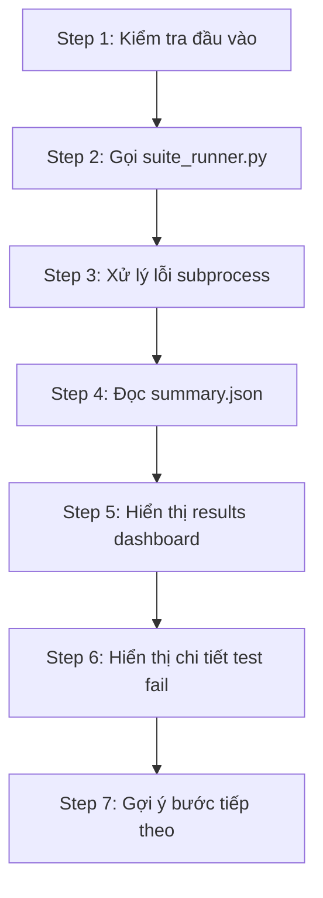

#### Step 1 — Kiểm Tra Đầu Vào (Pre-flight)

| | Chi tiết |
|---|---|
| **Input** | Tham số `--game`, `--suite`, `--env` |
| **Xử lý** | Kiểm tra tồn tại của `env.config.{suffix}.yml` cho môi trường `{env}`, kiểm tra file suite `.yml` có tồn tại |
| **Output** | Thông báo lỗi nếu thiếu file, hoặc tiếp tục |
| **Hiển thị trên màn hình** | Lỗi cụ thể nếu thiếu |

```
ERROR: Game config not found: games/zeus/env.config.prod.yml
ERROR: games/zeus/test-suites/test99.yml not found.
```

#### Step 2 — Gọi Suite Runner

| | Chi tiết |
|---|---|
| **Input** | Lệnh: `python framework/runner/suite_runner.py --game {game} --suite {suite} --env {env}` |
| **Xử lý** | Chạy subprocess, hiển thị thông báo chờ |
| **Output** | Exit code + stdout/stderr |
| **Hiển thị trên màn hình** | `"Running test3 for zeus on dev... (may take several minutes)"` |

Chi tiết những gì xảy ra bên trong subprocess:

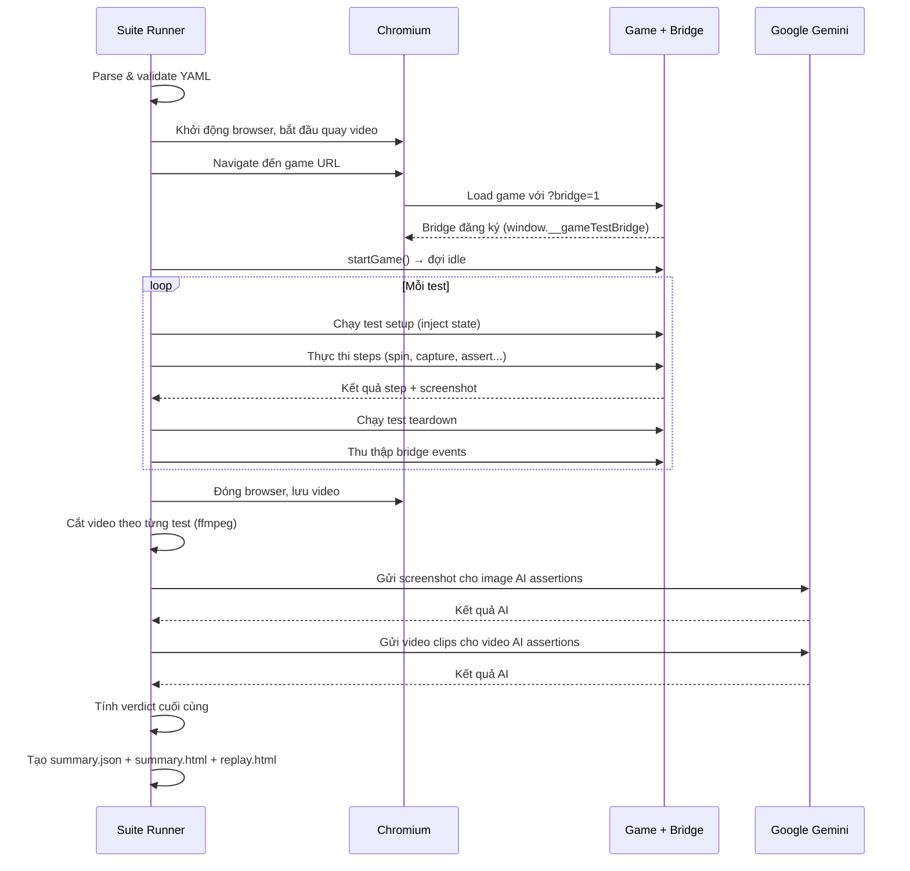

#### Step 3 — Xử Lý Lỗi Subprocess

| | Chi tiết |
|---|---|
| **Input** | Exit code và stdout/stderr của subprocess |
| **Xử lý** | Nếu exit code khác 0: phân loại lỗi (config, validation, runtime) |
| **Output** | Thông báo lỗi chi tiết |
| **Hiển thị trên màn hình** | Stdout và stderr nguyên bản |

#### Step 4 — Đọc summary.json

| | Chi tiết |
|---|---|
| **Input** | File `test-results/{game}/{env}/{suite}-{timestamp}/summary.json` |
| **Xử lý** | Parse JSON, đọc verdict từng test |
| **Output** | Dữ liệu kết quả có cấu trúc |

Nội dung `summary.json`:

```json
{
  "suite": "test3",
  "game": "zeus",
  "env": "dev",
  "run_date": "2026-04-20 15:00:02",
  "duration_ms": 127300,
  "total": 43,
  "counts": {
    "green": 40,
    "orange": 2,
    "red": 1,
    "pending": 0,
    "skip": 0
  },
  "tests": [
    {
      "test_id": "ZZ-01",
      "title": "Check UI Game",
      "bridge_result": "pass",
      "ai_result": "pass",
      "final_verdict": "green",
      "duration_ms": 2500,
      "error": null,
      "timed_out": false
    }
  ],
  "costs": {
    "image": { "calls": 35, "cost_usd": 0.0105 },
    "video": { "calls": 8, "cost_usd": 0.032 },
    "estimated_cost_usd": 0.0425
  }
}
```

#### Step 5 — Hiển Thị Results Dashboard

| | Chi tiết |
|---|---|
| **Input** | Dữ liệu từ `summary.json` |
| **Hiển thị trên màn hình** | Bảng kết quả màu với verdict từng test |

QA sẽ thấy:

```
=== Results: test3 | zeus | dev ===

[GREEN]   ZZ-01  Check UI Game               bridge=pass  ai=pass    2.5s
[GREEN]   ZZ-02  Check Denomination           bridge=pass  ai=pass    1.8s
[GREEN]   ZZ-03  Increase/Decrease Bet        bridge=pass  ai=pass    3.2s
...
[ORANGE]  ZZ-22  Check Turbo                  bridge=pass  ai=fail    4.1s
[RED]     ZZ-27  Disconnect >20s              bridge=fail  ai=skip   31.5s
...

Summary: 40 green | 2 orange | 1 red | 0 pending
Duration: 127.3s
Cost: 35 image calls, 8 video calls, ~$0.04
Artifacts: test-results/zeus/dev/test3-20-04-2026-1500/
```

#### Step 6 — Hiển Thị Chi Tiết Test Fail

| | Chi tiết |
|---|---|
| **Input** | Các test có verdict orange hoặc red |
| **Hiển thị trên màn hình** | Chi tiết từng test fail với đường dẫn artifact và gợi ý |

```
=== Failure Details ===

[ORANGE] ZZ-22 "Check Turbo"
  bridge: pass | ai: fail | duration: 4.1s
  Error: AI expected turbo_indicator_visible=true but got false
  Screenshots: test-results/zeus/dev/test3-.../ZZ-22/step-03.jpg
  AI detail: test-results/zeus/dev/test3-.../ZZ-22/step-03-ai.json
  Replay: test-results/zeus/dev/test3-.../ZZ-22/replay.html
  Gợi ý: Kiểm tra screenshot — có thể cần thêm wait_ms trước capture

[RED] ZZ-27 "Disconnect >20s"
  bridge: fail | ai: skip | duration: 31.5s | timed_out: true
  Error: Timed out waiting for AppState='error' after 30000ms
  Replay: test-results/zeus/dev/test3-.../ZZ-27/replay.html
  Gợi ý: Tăng timeout_ms hoặc kiểm tra session timeout config
```

#### Step 7 — Gợi Ý Bước Tiếp Theo

| | Chi tiết |
|---|---|
| **Input** | Phân bố verdict |
| **Hiển thị trên màn hình** | Gợi ý cụ thể |

| Tình huống | Gợi ý |
|-----------|------|
| Tất cả green | "All tests passed. Chạy `/write-test` để mở rộng coverage." |
| Có orange | "N test(s) cần review (orange). Xem artifact và replay viewer." |
| Có red | "N test(s) fail (red). Fix trước khi mở rộng coverage." |
| Có pending | "N test(s) đang chờ AI xử lý. Đợi hoặc chạy lại." |

---

## 7. Command: /update-knowledge — Cập Nhật Khi Docs Thay Đổi

### Công Dụng

Phát hiện xem tài liệu game đã thay đổi so với lần `/init-knowledge` trước hay chưa. Nếu có thay đổi: báo cáo sự khác biệt và tạo lại knowledge files. Nếu không: báo cáo và dừng lại.

### Cú Pháp

```
/update-knowledge --game=zeus
```

### Điều Kiện Trước

| File | Tạo bởi | Mục đích |
|------|---------|---------|
| `games/{game}/.docs-hash.json` | `/init-knowledge` | Hash manifest lần trước |
| Files trong `games/{game}/docs/` | QA/Dev | Tài liệu hiện tại |

### Quy Trình Từng Bước

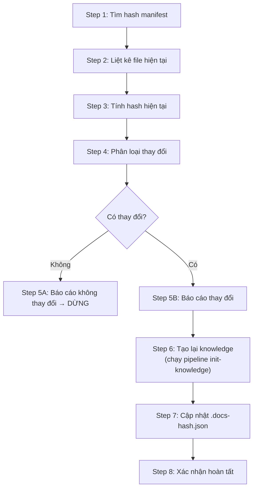

#### Step 1 — Tìm Hash Manifest

| | Chi tiết |
|---|---|
| **Input** | `games/{game}/.docs-hash.json` |
| **Xử lý** | Đọc file, ghi nhận `generated_at` timestamp |
| **Output** | Map `{file_path: hash}` từ lần trước |
| **Hiển thị trên màn hình** | Lỗi nếu file không tồn tại |

Nếu thiếu file:
```
ERROR: .docs-hash.json not found.
Run /init-knowledge --game=zeus first.
```

#### Step 2 — Liệt Kê File Hiện Tại

| | Chi tiết |
|---|---|
| **Input** | Thư mục `games/{game}/docs/` |
| **Xử lý** | Liệt kê đệ quy tất cả file |
| **Output** | Danh sách đường dẫn tương đối |

#### Step 3 — Tính Hash Hiện Tại

| | Chi tiết |
|---|---|
| **Input** | Danh sách file từ Step 2 |
| **Xử lý** | Tính SHA-256 cho từng file |
| **Output** | Map `{file_path: hash}` hiện tại |

#### Step 4 — Phân Loại Thay Đổi

| | Chi tiết |
|---|---|
| **Input** | Map cũ (Step 1) + Map mới (Step 3) |
| **Xử lý** | So sánh hai map |
| **Output** | 3 danh sách: Modified, New, Deleted |

| Phân loại | Điều kiện |
|-----------|----------|
| **Modified** | File tồn tại cả hai map, hash khác nhau |
| **New** | File chỉ có trong map mới |
| **Deleted** | File chỉ có trong map cũ |
| **Unchanged** | File tồn tại cả hai map, hash giống nhau |

#### Step 5 — Báo Cáo & Phân Nhánh

**Trường hợp A — Không có thay đổi:**

| | Chi tiết |
|---|---|
| **Hiển thị trên màn hình** | `"No changes detected since 2026-04-12. Knowledge files are up to date."` |
| **Output** | Không ghi file nào |

**Trường hợp B — Có thay đổi:**

| | Chi tiết |
|---|---|
| **Hiển thị trên màn hình** | Danh sách file thay đổi |

```
=== Documentation Changes Detected ===

Modified (2 files):
  - docs/raw/game-design-doc.pdf (hash changed)
  - docs/raw/paytable.xlsx (hash changed)

New (1 file):
  - docs/raw/reconnect-spec.md

Deleted (0 files):
  (none)

Proceeding with knowledge regeneration...
```

#### Step 6 — Tạo Lại Knowledge (Pipeline init-knowledge)

| | Chi tiết |
|---|---|
| **Input** | Tất cả file hiện tại trong `games/{game}/docs/` |
| **Xử lý** | Chạy lại toàn bộ pipeline `init-knowledge`: đọc tài liệu → phát hiện mechanic → **CHỜ QA xác nhận** → tạo `game-knowledge.md` → tạo `symbols.yml` |
| **Output** | Files đã cập nhật |

**Quan trọng:** QA vẫn phải xác nhận kết quả phát hiện mechanic (giống Step 3 của `/init-knowledge`).

#### Step 7 — Cập Nhật .docs-hash.json

| | Chi tiết |
|---|---|
| **Input** | Danh sách file hiện tại + hash mới |
| **Xử lý** | Ghi đè file `.docs-hash.json`. File đã xóa **KHÔNG** được đưa vào |
| **Output** | `games/{game}/.docs-hash.json` đã cập nhật |

#### Step 8 — Xác Nhận Hoàn Tất

| | Chi tiết |
|---|---|
| **Hiển thị trên màn hình** | Tổng kết thay đổi và file đã tạo lại |

```
=== update-knowledge complete ===

Changes processed:
  Modified: 2 files
  New: 1 file
  Deleted: 0 files

Files regenerated:
  - games/zeus/game-knowledge.md (updated)
  - games/zeus/docs/assets/symbols.yml (updated)
  - games/zeus/.docs-hash.json (updated)

Next steps:
  1. Review game-knowledge.md for accuracy
  2. Re-run /write-test if mechanics changed
```

---

## 8. Cấu Trúc File YAML Test Suite

### Ví Dụ Tối Thiểu

```yaml
suite: "My First Test Suite"          # Tiêu đề suite (STRING, không phải object)
game: zeus                            # Tên game
version: "1.0"                        # Phiên bản schema

config:
  test_timeout_ms: 60000              # Timeout mỗi test (60s)
  suite_timeout_ms: 600000            # Timeout toàn suite (10 phút)

setup:                                # Suite-level setup (chạy 1 lần)
  - action: navigate
    params: { url_script: "get_game_url" }
  - action: wait_for_state
    params: { state: "ready", timeout_ms: 30000 }
  - action: bridge_action
    params: { name: "startGame" }

teardown: []                          # Suite-level teardown (chạy sau MỖI test)

tests:                                # Danh sách test
  - id: ZZ-01
    title: "Game loads to idle"
    steps:
      - id: step-01
        action: wait_for_state
        params: { state: "idle" }
      - id: step-02
        action: capture
      - id: step-03
        assert:
          bridge:
            method: getAppState
            expected: "idle"
          ai:
            mode: image
            ref_screenshot: step-02
            ref_assets: [spin_button, balance_label]
            prompt: "Is the spin button visible? Is the balance showing a number?"
            output_schema:
              spin_visible: { type: boolean }
              balance_visible: { type: boolean }
              confidence: { type: string, enum: [high, medium, low] }
            expected:
              spin_visible: true
              balance_visible: true
              confidence: high
```

### Sơ Đồ Cấu Trúc

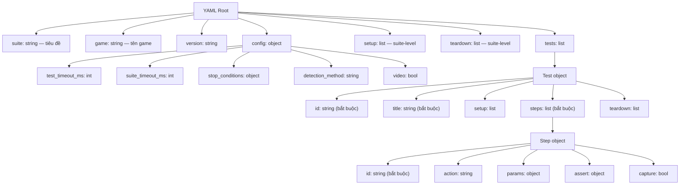

### Quy Tắc Quan Trọng

| Quy tắc | Chi tiết |
|---------|---------|
| `suite` là string | KHÔNG phải object. Chỉ là tiêu đề như `"Core UI Tests"` |
| Root-level keys | `suite`, `game`, `version`, `config`, `tests` đều ở cấp cao nhất — không bao giờ nest |
| Mỗi step cần `id` | Định dạng: `step-01`, `step-02`, ... (hoặc `setup-01`, `teardown-01`) |
| Test-level setup/teardown cần `id` | Suite-level setup/teardown KHÔNG cần `id` |
| `config` bắt buộc | Tối thiểu: `test_timeout_ms` và `suite_timeout_ms` |

### Config Block

```yaml
config:
  test_timeout_ms: 60000       # Timeout mỗi test (mặc định: 60s)
  suite_timeout_ms: 600000     # Timeout toàn suite (mặc định: 10 phút)
  detection_method: both       # "both", "phash", hoặc "gemini"
  video: true                  # Quay video cho video-mode AI assertions
  stop_conditions:
    fail_fast: false           # Dừng suite khi có test đầu tiên fail
    max_consecutive_failures: 3 # Dừng sau 3 lần fail liên tiếp
    max_total_failures: 10     # Dừng sau 10 lần fail tổng cộng
```

---

## 9. 12 Action Types

Chỉ có chính xác **12 action type** hợp lệ. Dùng bất kỳ loại nào khác sẽ gây lỗi validation.

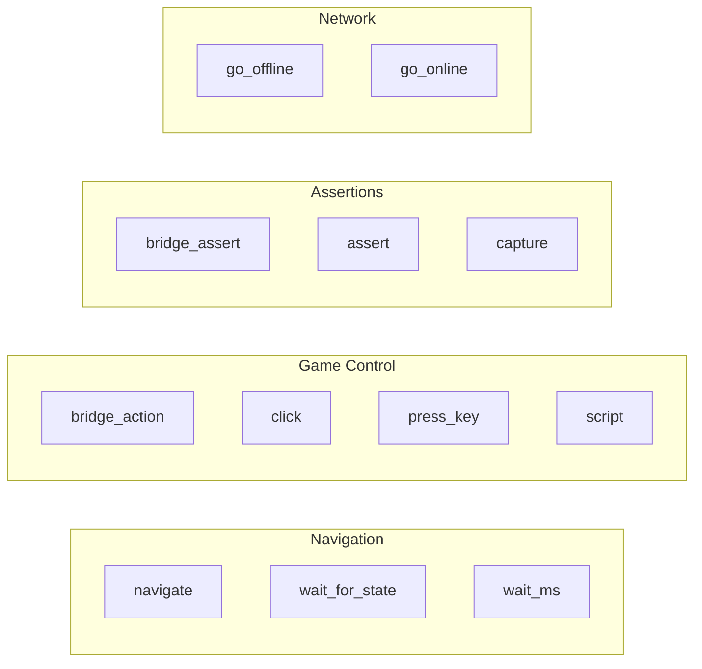

### Chi Tiết Từng Action

#### `navigate` — Load URL

```yaml
- id: step-01
  action: navigate
  params:
    url_script: "get_game_url"   # Lấy URL từ env.config.yml
    # HOẶC
    url: "http://example.com/game"  # URL cố định
```

| | Chi tiết |
|---|---|
| **Input** | `url` hoặc `url_script` |
| **Xử lý** | Playwright navigate đến URL, đợi `networkidle` |
| **Output** | Trang đã load xong |

#### `wait_for_state` — Đợi trạng thái game

```yaml
- id: step-02
  action: wait_for_state
  params:
    state: "idle"               # Trạng thái mục tiêu
    timeout_ms: 30000           # Thời gian đợi tối đa (mặc định: 30s)
```

| | Chi tiết |
|---|---|
| **Input** | `state` mục tiêu + `timeout_ms` |
| **Xử lý** | Poll bridge `getAppState()` cho đến khi khớp hoặc hết timeout |
| **Output** | Thành công (state khớp) hoặc lỗi timeout |

Các state hợp lệ: `idle`, `betting`, `result`, `ready`, `error`, `reconnecting`, `promo`

#### `bridge_action` — Gọi bridge method

```yaml
- id: step-03
  action: bridge_action
  params:
    name: "spin"                # Tên method
    # Tham số bổ sung được truyền làm argument:
    # name: "startAutoSpin"
    # count: 10
    # stopByWin: true
```

| | Chi tiết |
|---|---|
| **Input** | `name` (tên method) + các tham số bổ sung |
| **Xử lý** | Gọi `window.__gameTestBridge.{name}(...)` |
| **Output** | Giá trị trả về được lưu nội bộ (có thể dùng cho AI assertion) |

> **Lưu biến (`save:`)** — Thêm `save: <tên>` vào bất kỳ step nào trả về giá trị (thường là
> `bridge_action`) để lưu kết quả vào một biến trong phạm vi 1 test (setup → steps → teardown).
> Sau đó truyền biến đó cho một hàm assert của bridge qua `bridge_assert` với `args: ["$tên"]`.

#### `bridge_assert` — Kiểm tra giá trị bridge

```yaml
- id: step-04
  action: bridge_assert
  params:
    method: getAppState
    expected: "idle"

# Với args: hàm bridge tự kiểm tra giá trị đã lưu (deterministic)
- id: step-06
  action: bridge_assert
  params:
    method: isPayoutInRange       # bridge.isPayoutInRange(payout, 0, 100)
    args: ["$payout", 0, 100]      # "$payout" = biến đã save trước đó
    expected: true
```

| | Chi tiết |
|---|---|
| **Input** | `method` + `expected`; tùy chọn `args` (danh sách tham số) |
| **Xử lý** | Không có `args`: gọi `window.__gameTestBridge.{method}()`. Có `args`: gọi `{method}(...)` với các tham số đã resolve (`"$tên"` → biến đã save), so sánh kết quả với `expected` |
| **Output** | `pass` nếu khớp, `fail` nếu không khớp |

> Lưu ý: khối con `assert.bridge` (bên trong block `assert:`) vẫn CHỈ nhận `method` + `expected`.
> `args` chỉ áp dụng cho **action** `bridge_assert`. Bridge phải thực sự expose hàm assert được gọi.

#### `capture` — Chụp screenshot

```yaml
- id: step-05
  action: capture
```

| | Chi tiết |
|---|---|
| **Input** | Không có |
| **Xử lý** | Chụp màn hình hiện tại |
| **Output** | File `step-05.jpg` trong thư mục output của test |

#### `assert` — Assertion thuần túy (không có action)

```yaml
- id: step-06
  assert:
    bridge:
      method: getBalance
      expected: 100.00
    ai:
      mode: image
      ref_screenshot: step-05
      prompt: "Is the balance displayed as 100.00?"
      output_schema:
        balance_correct: { type: boolean }
        confidence: { type: string, enum: [high, medium, low] }
      expected:
        balance_correct: true
        confidence: high
```

| | Chi tiết |
|---|---|
| **Input** | Block `assert` với `bridge` và/hoặc `ai` |
| **Xử lý** | Chạy assertion mà không thực hiện action nào |
| **Output** | Kết quả pass/fail |

Trường `action` có thể bỏ qua khi có block `assert`.

#### `click` — Click element hoặc tọa độ

```yaml
# Click CSS selector
- id: step-07
  action: click
  params:
    selector: "#start-button"

# Click tọa độ canvas
- id: step-08
  action: click
  params:
    x: 265
    y: 750
```

| | Chi tiết |
|---|---|
| **Input** | `selector` HOẶC (`x` + `y`) |
| **Xử lý** | Playwright click tại vị trí chỉ định |
| **Output** | Element/vị trí đã được click |

#### `press_key` — Nhấn phím bàn phím

```yaml
- id: step-09
  action: press_key
  params:
    key: "Space"    # "Space", "Enter", "Escape", v.v.
```

| | Chi tiết |
|---|---|
| **Input** | `key` (tên phím) |
| **Xử lý** | Playwright nhấn phím |
| **Output** | Phím đã được nhấn |

#### `wait_ms` — Đợi một khoảng thời gian

```yaml
- id: step-10
  action: wait_ms
  params:
    ms: 2000        # Đợi 2 giây
```

| | Chi tiết |
|---|---|
| **Input** | `ms` (phải > 0) |
| **Xử lý** | Sleep N milliseconds |
| **Output** | Tiếp tục sau khi hết thời gian |

#### `go_offline` / `go_online` — Mô phỏng mất mạng

```yaml
- id: step-11
  action: go_offline    # Tắt kết nối mạng

- id: step-12
  action: go_online     # Khôi phục kết nối mạng
```

| | Chi tiết |
|---|---|
| **Input** | Không có |
| **Xử lý** | Thay đổi trạng thái mạng của browser context |
| **Output** | Mạng đã ngắt / mạng đã khôi phục |

#### `script` — Chạy JavaScript trong browser

```yaml
- id: step-13
  action: script
  params:
    cmd: "return window.__gameTestBridge.getSnapshot()"
```

| | Chi tiết |
|---|---|
| **Input** | `cmd` (JavaScript code) |
| **Xử lý** | Chạy trong browser context, có thể truy cập `bridge`, `steps`, `assert_equal` |
| **Output** | Giá trị trả về |

---

## 10. Viết Assertions

### Hệ Thống Dual Assertion

Mỗi test nên có **cả hai** bridge assertion (state nội bộ) và AI assertion (màn hình). Điều này bắt được lỗi mà một validator riêng lẻ sẽ bỏ sót.

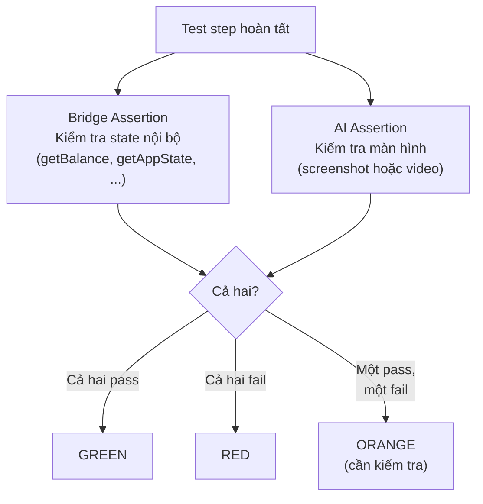

### Bridge Assertion

Gọi bridge getter method và so sánh giá trị trả về với `expected`:

```yaml
assert:
  bridge:
    method: getAppState      # Tên method
    expected: "idle"          # Giá trị mong đợi (so sánh bằng)
```

**Chỉ 2 trường** `method` và `expected`. Không có trường nào khác.

### AI Assertion — Image Mode

Gửi screenshot cho Gemini phân tích:

```yaml
assert:
  ai:
    mode: image
    ref_screenshot: step-03              # Screenshot từ step capture nào
    ref_assets: [spin_button, coin]      # Ảnh tham chiếu từ symbols.yml
    prompt: "Is the spin button visible? Are there 3 coin symbols on the grid?"
    output_schema:
      spin_visible: { type: boolean }
      coin_count: { type: number }
      confidence: { type: string, enum: [high, medium, low] }
    expected:
      spin_visible: true
      coin_count: 3
      confidence: high
```

| Trường | Bắt buộc | Mô tả |
|--------|---------|------|
| `mode` | Có | `image` |
| `ref_screenshot` | Có | ID của step `capture` trước đó |
| `ref_assets` | Không | Key từ `symbols.yml`, chỉ chọn liên quan |
| `prompt` | Có | Câu hỏi cụ thể, có giá trị chính xác |
| `output_schema` | Có | Định nghĩa các trường Gemini phải trả về |
| `expected` | Có | Giá trị mong đợi, khớp với `output_schema` |

**Khi nào dùng Image Mode:** Khi **1 screenshot end-state** đủ để kiểm tra pass/fail:
- Element hiển thị / ẩn
- Giá trị cụ thể (balance, bet, counter)
- Popup mở / đóng
- Symbol trên grid

### AI Assertion — Video Mode

Gửi video clip cho Gemini phân tích:

```yaml
assert:
  ai:
    mode: video
    video_trim:
      from_step: step-01                 # Bắt đầu từ step nào
      to_step: step-05                   # Kết thúc tại step nào
    ref_assets: [coin, hold_spin_overlay]
    prompt: "Did the reels spin and then transition to Hold & Spin bonus?"
    output_schema:
      reels_spun: { type: boolean }
      bonus_entered: { type: boolean }
      confidence: { type: string, enum: [high, medium, low] }
    expected:
      reels_spun: true
      bonus_entered: true
      confidence: high
```

| Trường | Bắt buộc | Mô tả |
|--------|---------|------|
| `mode` | Có | `video` |
| `video_trim` | Có | `from_step` và `to_step` xác định đoạn video |
| `ref_assets` | Không | Ảnh tham chiếu |
| `prompt` | Có | Câu hỏi về transition/animation |
| `output_schema` | Có | Các trường Gemini phải trả về |
| `expected` | Có | Giá trị mong đợi |

**Khi nào dùng Video Mode:** Khi cần xem **transition, animation hoặc chuỗi sự kiện**:
- Reel quay và dừng
- Popup mở rồi đóng
- Auto-spin chạy nhiều vòng
- Chuyển cảnh vào bonus

### Quy Tắc Viết Prompt

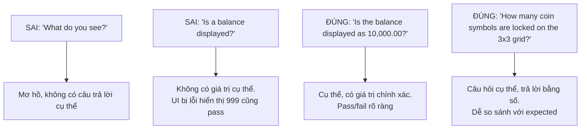

| Quy tắc | Ví dụ |
|---------|------|
| Hỏi cụ thể, closed-ended | "Is the bet label showing 0.20?" |
| Đưa giá trị chính xác vào | Không nói "a balance" — nói "10,000.00" |
| Luôn có `output_schema` | Định nghĩa kiểu dữ liệu Gemini phải trả về |
| Luôn có `expected` | Phải khớp với trường trong `output_schema` |
| Luôn có `confidence` | `enum: [high, medium, low]` — `low` = fail |
| Chỉ chọn `ref_assets` liên quan | Không dump tất cả symbol — chỉ chọn cái prompt cần |

---

## 11. Đọc Kết Quả Test

### Cấu Trúc Thư Mục Output

```
test-results/zeus/dev/test3-20-04-2026-1500/
├── summary.json              # Kết quả đọc bằng máy
├── summary.html              # MỞ FILE NÀY TRONG BROWSER!
│
├── ZZ-01/
│   ├── result.json           # Verdict + metadata
│   ├── result.html           # Thẻ verdict có style
│   ├── timeline.json         # Thời gian từng step
│   ├── events.jsonl          # Log event bridge
│   ├── session.webm          # Video của test này
│   ├── step-02.jpg           # Screenshot từ step-02
│   ├── step-02-ai.json       # Kết quả AI phân tích
│   └── replay.html           # Replay viewer tương tác
│
├── ZZ-02/
│   └── ...
└── ZZ-43/
    └── ...
```

### summary.html — Bắt Đầu Từ Đây

Mở `summary.html` trong browser. Bạn sẽ thấy:

| Cột | Hiển thị |
|-----|---------|
| Test ID | `ZZ-01`, `ZZ-02`, ... |
| Title | Tên test |
| Bridge | `pass` hoặc `fail` — kiểm tra state nội bộ |
| AI | `pass`, `fail`, hoặc `skip` — kiểm tra màn hình |
| Verdict | `green`, `orange`, hoặc `red` (có màu) |
| Duration | Thời gian chạy test |
| Error | Thông báo lỗi nếu test fail |

### result.json — Chi Tiết Từng Test

```json
{
  "test_id": "ZZ-05",
  "title": "Balance deduction on bet",
  "bridge_result": "pass",
  "ai_result": "pass",
  "final_verdict": "green",
  "duration_ms": 3200,
  "timed_out": false,
  "error": null
}
```

### step-N-ai.json — Kết Quả AI

Khi AI assertion pass:

```json
{
  "passed": true,
  "data": {
    "balance_displayed": true,
    "balance_value": "9,999.80",
    "confidence": "high"
  },
  "expected": {
    "balance_displayed": true,
    "balance_value": "9,999.80",
    "confidence": "high"
  },
  "mismatches": []
}
```

Khi AI assertion fail, `mismatches` cho biết trường nào không khớp:

```json
{
  "passed": false,
  "data": {
    "balance_value": "10,000.00",
    "confidence": "high"
  },
  "expected": {
    "balance_value": "9,999.80",
    "confidence": "high"
  },
  "mismatches": ["balance_value: got '10,000.00', expected '9,999.80'"]
}
```

---

## 12. Replay Viewer

Mỗi test tạo ra file `replay.html` — công cụ tương tác để kiểm tra kết quả test.

### Giao Diện

```
┌──────────────────────────────────────────────────────────────┐
│  Event Filters: [STATE] [SPIN] [BALANCE] [BUTTON] [STEP]    │
├────────────────────────────┬─────────────────────────────────┤
│                            │                                 │
│   Video Player             │   Event Log                     │
│                            │                                 │
│   (có thể tua, điều chỉnh │   0.31s  STEP step-01           │
│    tốc độ 1x/2x/0.5x)     │          bridge_action: spin    │
│                            │   0.45s  STATE idle → betting   │
│                            │   1.14s  SPIN_RESULT            │
│                            │          reels: [[1,3,5],...]   │
│                            │          payout: 0.40           │
│                            │   1.14s  BALANCE_CHANGE         │
│                            │          100.00 → 100.20        │
│                            │   2.50s  STATE result → idle    │
│                            │                                 │
├────────────────────────────┴─────────────────────────────────┤
│  Timeline: [step-01 ████] [step-02 ██] [step-03 ████████]   │
└──────────────────────────────────────────────────────────────┘
```

### Cách Sử Dụng

1. **Mở** `replay.html` trong browser bất kỳ
2. **Click event** ở panel phải để nhảy video đến thời điểm đó
3. **Click step** ở thanh timeline phía dưới để tua đến đầu step
4. **Lọc event** bằng thanh filter phía trên (bật/tắt loại event)
5. **Điều chỉnh tốc độ** để xem chậm hoặc nhanh

### Khi Nào Cần Dùng

| Tình huống | Hành động |
|-----------|---------|
| **Red verdict** | Xem chính xác điều gì đã xảy ra khi test fail |
| **Orange verdict** | So sánh bridge report với những gì hiển thị trên màn hình |
| **Test không ổn định** | Xem thời gian chuyển đổi trạng thái |
| **Kiểm tra animation** | Tua lại và xem lại ở tốc độ 0.5x |

---

## 13. Hệ Thống Verdict

### Cách Tính Verdict

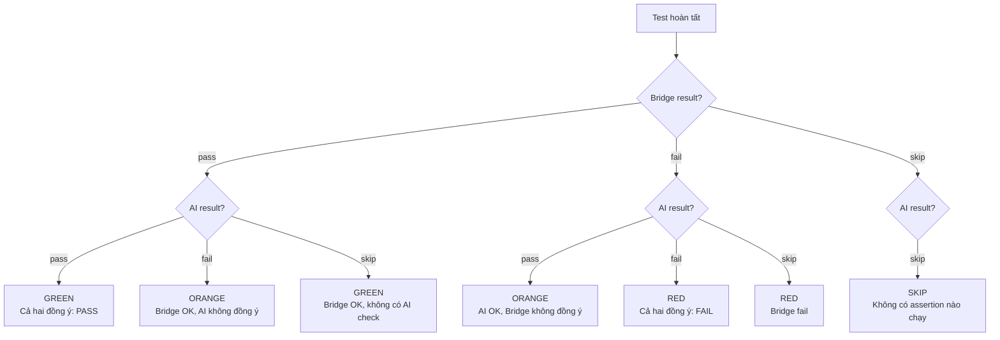

### Ý Nghĩa Từng Verdict

| Verdict | Màu | Ý nghĩa | Cần làm gì |
|---------|-----|---------|-----------|
| **Green** | Xanh | Test pass | Không cần làm gì |
| **Orange** | Cam | Bridge và AI không nhất quán | Cần kiểm tra: mở replay viewer, xem screenshot |
| **Red** | Đỏ | Test fail | Tìm lỗi hoặc sửa test |
| **Pending** | Đợi | AI chưa xử lý xong | Đợi AI batch hoàn tất |
| **Skip** | Bỏ qua | Test bị bỏ hoặc không có assertion | Kiểm tra nếu có chủ đích |

### Tìm Hiểu Orange Verdict

Orange nghĩa là 2 validator không nhất quán. Thường chỉ ra:

| Tình huống | Bridge | AI | Nguyên nhân thường gặp |
|-----------|--------|----|---------------------|
| Lỗi render UI | pass | fail | State đúng nhưng UI không hiển thị |
| Screenshot cũ | pass | fail | Chụp màn hình trước khi UI cập nhật |
| AI đọc sai | pass | fail | Gemini hiểu sai screenshot (kiểm tra prompt) |
| Bridge query sớm | fail | pass | Bridge query quá sớm/muộn, nhưng UI hiển thị đúng |

---

## 14. AI Assertion Chi Tiết

### Luồng Xử Lý Image Mode

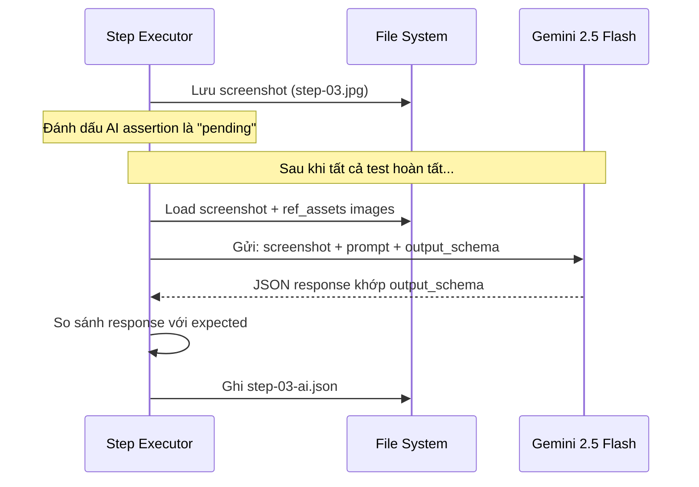

### Luồng Xử Lý Video Mode

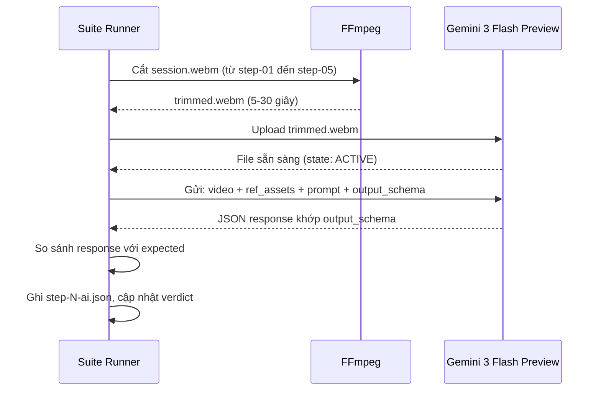

### Hướng Dẫn Chọn Image vs Video

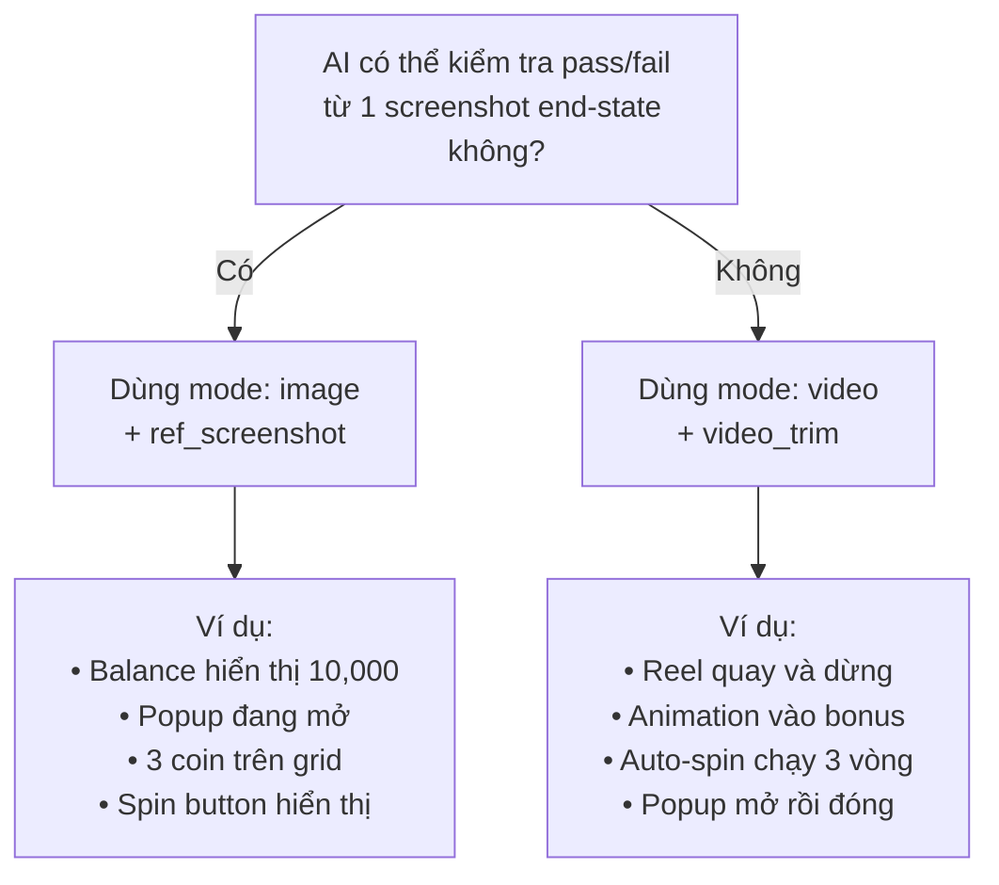

---

## 15. Bridge API Tham Khảo Nhanh

Bridge là JavaScript object (`window.__gameTestBridge`) được framework gọi qua Playwright. Bạn tham chiếu bridge methods trong các step `bridge_action` và `bridge_assert`.

### Actions Thường Dùng

| Method | Chức năng | Dùng trong YAML |
|--------|---------|----------------|
| `startGame()` | Click nút Start, đợi idle | `bridge_action: { name: startGame }` |
| `spin()` | Quay reel, đợi idle | `bridge_action: { name: spin }` |
| `nextBet()` | Tăng bet 1 bậc | `bridge_action: { name: nextBet }` |
| `previousBet()` | Giảm bet 1 bậc | `bridge_action: { name: previousBet }` |
| `openAutoPopup()` | Mở popup auto-spin | `bridge_action: { name: openAutoPopup }` |
| `startAutoSpin(count, stopByWin)` | Bắt đầu auto-spin | `bridge_action: { name: startAutoSpin, count: 10, stopByWin: false }` |
| `stopAutoSpin()` | Dừng auto-spin | `bridge_action: { name: stopAutoSpin }` |
| `openBuyBonusPopup()` | Mở popup buy bonus | `bridge_action: { name: openBuyBonusPopup }` |
| `confirmBuyBonus(index)` | Mua bonus package | `bridge_action: { name: confirmBuyBonus, packageIndex: 0 }` |
| `setTurbo(enabled)` | Bật/tắt turbo | `bridge_action: { name: setTurbo, enabled: true }` |
| `setSound(enabled)` | Bật/tắt âm thanh | `bridge_action: { name: setSound, enabled: false }` |
| `openInfo()` | Mở popup paytable/info | `bridge_action: { name: openInfo }` |
| `openHistory()` | Mở popup lịch sử bet | `bridge_action: { name: openHistory }` |
| `setDevModeResult(grid)` | Inject kết quả spin tiếp theo | `bridge_action: { name: setDevModeResult, grid: [[1,3,4],[3,4,1],[13,13,13]] }` |
| `resetDevMode()` | Xóa kết quả đã inject | `bridge_action: { name: resetDevMode }` |

### Queries Thường Dùng (cho bridge_assert)

| Method | Trả về | Ví dụ expected |
|--------|--------|---------------|
| `getAppState()` | `"idle"`, `"betting"`, `"result"`, `"error"` | `"idle"` |
| `getSpinState()` | `"NORMAL"`, `"START_BONUS"`, `"IN_BONUS"`, `"END_BONUS"` | `"NORMAL"` |
| `getBalance()` | `number` | `9999.80` |
| `getBetAmount()` | `number` | `0.20` |
| `getDenominations()` | `[0.20, 0.40, 1.00, ...]` | `[0.20, 0.40, 1.00]` |
| `getLastPayout()` | `number` | `5.00` |
| `getLastWinType()` | `"LOSE"`, `"SLIM_WIN"`, `"BIG_WIN"`, ... | `"LOSE"` |
| `isSpinEnabled()` | `boolean` | `true` |
| `isBuyBonusEnabled()` | `boolean` | `false` |
| `isAutoEnabled()` | `boolean` | `true` |
| `isNextBetEnabled()` | `boolean` | `true` |
| `isPreviousBetEnabled()` | `boolean` | `false` |
| `isStopAutoVisible()` | `boolean` | `true` |
| `isTurboActive()` | `boolean` | `true` |
| `isSoundEnabled()` | `boolean` | `false` |
| `getFreeSpinsRemaining()` | `number` (counter re-spin trong H&S) | `3` |
| `getAutoSpinsRemaining()` | `number` hoặc `Infinity` | `7` |
| `getDisplayBalance()` | `string` (đã format) | `"10,000.00"` |
| `getDisplayBet()` | `string` (đã format) | `"0.20"` |
| `getDisplayWin()` | `string` (đã format) | `"5.00"` |
| `getCoinPositions()` | `[{row, col, coinValue, type}, ...]` | (object phức tạp) |

### Dev Mode — Điều Khiển Kết Quả Spin

Dùng `setDevModeResult` để inject kết quả cố định. Grid là mảng 3x3 các symbol ID:

```
Symbol IDs:
  1=A  3=Q  4=K  5=P1(Crow)  6=P2(Cup)
  7=P3(Ring)  8=P4(Time)  9=Wild  13=Coin
```

```yaml
# Inject kết quả thua (không có payline trúng)
- id: setup-01
  action: bridge_action
  params:
    name: setDevModeResult
    grid: [[1,3,4],[3,4,1],[4,1,3]]

# Inject 3 coin ở hàng dưới (trigger Hold & Spin)
- id: setup-01
  action: bridge_action
  params:
    name: setDevModeResult
    grid: [[1,3,4],[3,4,1],[13,13,13]]

# Inject 9 coin (full grid → bonus giải quyết ngay)
- id: setup-01
  action: bridge_action
  params:
    name: setDevModeResult
    grid: [[13,13,13],[13,13,13],[13,13,13]]
```

Luôn gọi `resetDevMode` trong teardown để xóa kết quả đã inject.

---

## 16. Chi Phí & Hiệu Suất

### Chi Phí AI Assertion

| Mode | Model | Chi phí mỗi lần gọi | Sử dụng |
|------|-------|-------------------|---------|
| Image | Gemini 2.5 Flash | ~$0.0003 | Đa số assertion |
| Video | Gemini 3 Flash Preview | ~$0.004 | Kiểm tra animation/transition |

### Chi Phí Ví Dụ Theo Suite

| Kích thước suite | Image Assertions | Video Assertions | Chi phí ước tính |
|-----------------|-----------------|-----------------|-----------------|
| 10 tests | 10 | 0 | ~$0.003 |
| 20 tests | 15 | 5 | ~$0.025 |
| 40 tests | 30 | 10 | ~$0.05 |

### Hiệu Suất

| Chỉ số | Giá trị thường thấy |
|--------|-------------------|
| Validate suite | < 1 giây |
| Khởi động browser | 2-3 giây |
| Suite setup (load game) | 3-5 giây |
| Mỗi test (trung bình) | 2-5 giây |
| Cắt video | 1-2 giây mỗi test |
| AI image batch | 5-15 giây tổng |
| AI video batch | 10-30 giây tổng |
| **Suite 20 test tổng** | **60-90 giây** |

### Mẹo Tăng Tốc

- Dùng `mode: image` thay vì `mode: video` khi có thể (rẻ hơn 10 lần, nhanh hơn)
- Đặt `fail_fast: true` trong lúc phát triển để dừng ngay khi có lỗi đầu tiên
- Giảm `test_timeout_ms` nếu biết test chạy nhanh
- Dùng `setDevModeResult` để tạo kết quả cố định (không phải đợi kết quả cụ thể)

---

## 17. Xử Lý Lỗi Thường Gặp

### "Schema validation failed"

```
ERROR: Schema validation failed:
  - tests[2].steps[3]: action 'bridge_query' is not a supported action type
```

**Nguyên nhân:** Dùng action type không hợp lệ.
**Cách xử lý:** Chỉ dùng 12 action type. Xem [Mục 9](#9-12-action-types). Lỗi thường gặp:
- `bridge_query` → dùng `bridge_action` (giá trị trả về được lưu)
- `reload` → dùng `navigate` + `wait_for_state` + `bridge_action: startGame`
- `wait` → dùng `wait_ms` với `params: { ms: N }`

### "Bridge not found"

```
ERROR: window.__gameTestBridge is not registered
```

**Nguyên nhân:** URL game không có `?bridge=1` hoặc bridge chưa khởi tạo.
**Cách xử lý:** Kiểm tra `env.config.yml` — đảm bảo `browser_params` có `?bridge=1`.

### "Timed out waiting for state 'idle'"

```
ERROR: Timed out after 30000ms waiting for AppState='idle'
```

**Nguyên nhân:** Game không đạt trạng thái idle trong thời gian chờ (có thể bonus đã trigger, hoặc game load chậm).
**Cách xử lý:**
- Tăng `timeout_ms` trong step `wait_for_state`
- Với spin có thể trigger bonus: dùng `timeout_ms: 120000`
- Kiểm tra popup có đang chặn game không

### "Test timed out"

```
ERROR: Test ZZ-15 timed out after 60000ms
```

**Nguyên nhân:** Toàn bộ test vượt quá `test_timeout_ms`.
**Cách xử lý:** Tăng `test_timeout_ms` trong config, hoặc chia test thành các test nhỏ hơn.

### "ffmpeg not found"

```
ERROR: ffmpeg not found. Install from https://ffmpeg.org/download.html
```

**Nguyên nhân:** Cắt video cần ffmpeg.
**Cách xử lý:** Cài ffmpeg và đảm bảo có trong PATH.

### AI assertion trả về kết quả không đúng

**Nguyên nhân:** Prompt quá mơ hồ, hoặc `ref_screenshot` trỏ sai.
**Cách xử lý:**
1. Xem `step-N-ai.json` để đọc raw AI response
2. Xem screenshot thực tế (`step-N.jpg`) — có hiển thị đúng không?
3. Làm prompt cụ thể hơn với giá trị chính xác
4. Đảm bảo `ref_screenshot` trỏ đúng step `capture`

### Orange verdict (bridge pass, AI fail)

**Nguyên nhân:** Bridge nói state đúng, nhưng AI không thấy trên màn hình.
**Cách xử lý:**
1. Mở replay viewer — screenshot có chụp đúng thời điểm không?
2. Thêm `wait_ms` trước step `capture` để chờ UI cập nhật
3. Kiểm tra prompt có hỏi đúng thứ không

---

## 18. Thuật Ngữ

| Thuật ngữ | Định nghĩa |
|-----------|-----------|
| **Bridge** | JavaScript object inject vào game (`window.__gameTestBridge`) cho phép framework điều khiển và query game |
| **Bridge assertion** | Kiểm tra state nội bộ game bằng cách gọi bridge getter method và so sánh giá trị trả về |
| **AI assertion** | Gửi screenshot hoặc video cho Google Gemini AI để xác nhận trạng thái màn hình |
| **Dual assertion** | Dùng cả bridge và AI assertion trong cùng test để phủ bài tối đa |
| **Suite** | File YAML chứa cấu hình và danh sách test |
| **Step** | Một hành động đơn trong test (spin, capture, assert, ...) |
| **Verdict** | Kết quả cuối cùng: green, orange, red, pending, hoặc skip |
| **ref_assets** | Ảnh tham chiếu từ `symbols.yml` gửi cho Gemini làm ngữ cảnh |
| **ref_screenshot** | Tham chiếu đến screenshot của step `capture` trước đó |
| **video_trim** | Xác định điểm bắt đầu và kết thúc của video clip cho video-mode AI assertion |
| **output_schema** | JSON schema ràng buộc định dạng trả về của Gemini |
| **DevMode** | Tính năng inject kết quả spin cụ thể để test có kết quả xác định |
| **Hold & Spin** | Mechanic bonus trigger bởi coin symbol. Game khóa coin và cho re-spin |
| **Replay viewer** | Công cụ HTML tương tác hiển thị video + event log đồng bộ để điều tra kết quả test |
| **AppState** | Trạng thái hiện tại của game: `idle`, `betting`, `result`, `error`, `reconnecting`, `promo` |
| **SpinState** | Trạng thái bonus: `NORMAL`, `START_BONUS`, `IN_BONUS`, `END_BONUS` |
| **Coverage report** | Báo cáo phủ bài cho thấy mechanic nào đã test, bridge method nào đã dùng, assertion nào còn thiếu |
| **Hash manifest** | File `.docs-hash.json` lưu SHA-256 hash của tất cả tài liệu để phát hiện thay đổi |
| **Canonical pattern** | Mẫu test chuẩn cho từng mechanic, được định nghĩa trong `shared-mechanisms/` |
